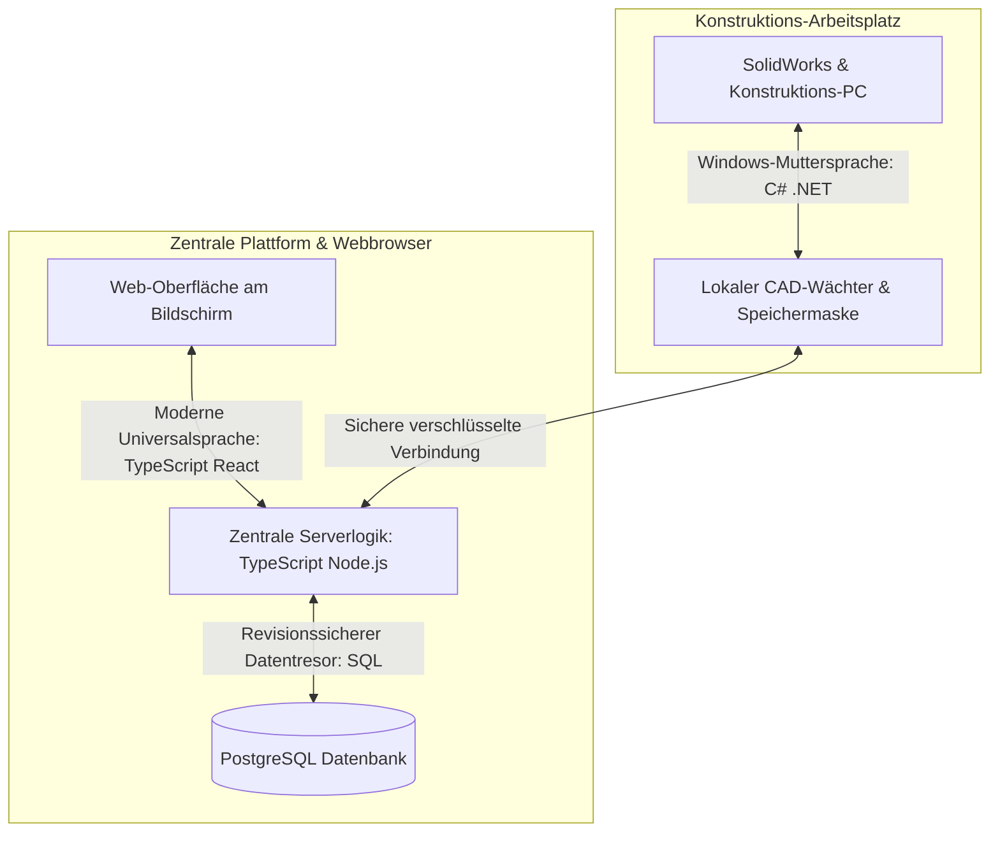
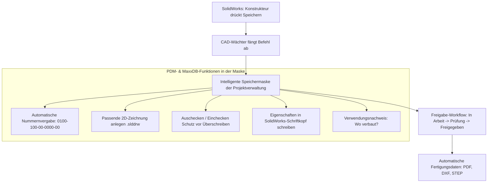

# Umfassender Implementierungsplan: Modulare Web-Projektverwaltung, CAD-Zentrale & Firmen-Plattform

Dieses Dokument beschreibt die vollständige Konzeption und schrittweise Umsetzung einer modernen, browserbasierten Projektverwaltungs- und Kollaborationsplattform für Industrie, Ingenieurbüros und Unternehmen. 

Das System ist flexibel einsetzbar: Es läuft auf stromsparenden Kleincomputern (wie ARM-Minicomputern), auf Arbeitsplatzrechnern und **vor allem auf dedizierten Firmen-Servern im echten Produktivbetrieb**.

Alle Zusammenhänge sind nachfolgend **vollständig ohne technisches Fachchinesisch** und in klarer, anschaulicher Alltagssprache erklärt.

---

## 1. Frische, unbenutzte Namensvorschläge für die Plattform

Hier sind 6 frische und unverbrauchte Namensvorschläge, die noch nicht von bekannten Großlösungen belegt sind und die Verbindung aus Projektmanagement, Konstruktion und Teamarbeit perfekt auf den Punkt bringen:

1. **KonstruDesk** *(Verbindet Konstruktion, Technik und die intuitive Schreibtisch-Zentrale)*
2. **IngeniFlow** *(Betont den reibungslosen, hindernisfreien Arbeitsfluss für Ingenieure, Techniker und Teams)*
3. **PartOrbit** *(Bildhafte Metapher: Das Zentrum, um das alle Bauteile, Zeichnungen und Projekte sicher kreisen)*
4. **ModulCraft** *(Betont die modulare Baukasten-Architektur und höchste handwerklich-technische Qualität)*
5. **VektorHub** *(Vektor steht für Richtung, Zielstrebigkeit und CAD-Präzision; Hub für den gemeinsamen Knotenpunkt)*
6. **AperioPlan** *(Abgeleitet vom lateinischen „aperio“ = offenlegen, klar sichtbar machen; steht für absolute Transparenz in Projekten)*

---

## 2. Die Programmiersprachen: Modern, langlebig & leicht zu warten

Damit die Software über viele Jahre hinweg stabil, rasend schnell und ohne ständigen Wartungsaufwand läuft, setzen wir auf ein klares, zweigeteiltes Sprachen-Konzept. 



### Warum diese Sprachen gewählt werden (Einfach erklärt):

1. **TypeScript für die gesamte Web-Plattform (Browser & Server):**
   * **Was das ist:** TypeScript ist die weltweite moderne Standardsprache für anspruchsvolle Webanwendungen (wird u. a. von Microsoft, Google, Kaneo und Notion eingesetzt).
   * **Der „Automatische Bauplanprüfer“:** Im Gegensatz zu älteren Sprachen prüft TypeScript bereits während des Schreibens jeden einzelnen Baustein auf Herz und Nieren. Wenn ein Bauteil oder eine Aufgabe nicht exakt zur Schnittstelle passt, schlägt das System sofort Alarm, bevor das Programm überhaupt gestartet wird. Fehler werden im Keim erstickt.
   * **Alles aus einem Guss (Eine Sprache für alles):** Das, was der Benutzer im Browser sieht (die Oberfläche), und das, was auf dem Server rechnet (die Datenbank-Logik), sprechen dieselbe Sprache. Dadurch ist der Code extrem aufgeräumt, leicht verständlich und von jedem Entwickler weltweit sofort wartbar.
   * **Leichtgewichtiger Server (Node.js mit Fastify):** Verbraucht minimalen Arbeitsspeicher. Dadurch läuft die Zentrale selbst auf sparsamsten Minicomputern (ARM) flüsterleise und bewältigt auf großen Firmen-Servern tausende Anfragen gleichzeitig ohne Verzögerung.

2. **C# (.NET) für den lokalen CAD-Speicher-Wächter auf Windows-Rechnern:**
   * **Was das ist:** C# ist die offizielle Muttersprache des Windows-Betriebssystems und der SolidWorks-Schnittstelle.
   * **Warum C# hier die einzig richtige Wahl ist:** Da SolidWorks ein reines Windows-Programm ist, kann sich ein kleines Helferprogramm in C# nahtlos und ohne spürbaren Leistungsverlust direkt in den SolidWorks-Prozess einklinken, das Speichern abfangen und die Eingabemaske öffnen.

3. **PostgreSQL als Datenbank-Tresor:**
   * Gilt in der gesamten Industrie als die zuverlässigste, stabilste und verlustsicherste Open-Source-Datenbank der Welt. Sie garantiert, dass selbst bei einem Stromausfall keine einzige Buchung oder Datei verloren geht.

---

## 3. Bereitstellung für den produktiven Firmen-Einsatz auf einem Server

Damit die Software in Unternehmen rund um die Uhr ausfallsicher und verlässlich läuft, wird sie für den professionellen Server-Einsatz vorbereitet:

* **Einfache Server-Inbetriebnahme (Ein-Befehl-Start):**
  * Das gesamte System wird so geschnürt, dass es auf jedem Linux-Server (z. B. Ubuntu, Debian) oder Firmen-Server mit nur einem einzigen Startbefehl komplett betriebsbereit hochfährt.
  * Alle Bestandteile (Bedienoberfläche, Rechenzentrum, Datenbank, Dateispeicher) sind isoliert voneinander gebündelt und beeinflussen keine anderen Programme auf dem Server.
* **Das Sicherheitsschloss (Automatische HTTPS-Verschlüsselung):**
  * Auf dem Server wird ein automatischer „digitaler Pförtner“ eingerichtet. Dieser sorgt dafür, dass jeder Zugriff von außen über ein sicheres grünes Sicherheitsschloss (HTTPS) verschlüsselt ist. Passwörter und Firmendaten können im Netzwerk von niemandem abgefangen oder mitgelesen werden.
* **Automatischer Nacht-Tresor (Geplante Sicherungen):**
  * Das System erstellt jede Nacht zu einer frei wählbaren Uhrzeit (z. B. um 02:00 Uhr) automatisch eine vollständige, verschlüsselte Sicherung aller Projekte, Zeiterfassungen und Dokumente.
  * Diese Sicherung kann wahlweise auf eine separate Server-Festplatte oder ein Firmen-Netzlaufwerk (NAS) abgelegt werden.
* **Ausfallsicherheit & Selbstheilung:**
  * Ein integrierter „Wächterdienst“ prüft ununterbrochen, ob alle Dienste ordnungsgemäß reagieren. Sollte es zu einer Störung kommen, startet das System den betroffenen Dienst in Sekundenschnelle selbstständig neu.
* **Firmen-Login (Zentrales Mitarbeiterverzeichnis):**
  * Mitarbeiter können sich wahlweise mit ihren gewohnten Windows- bzw. Firmen-Zugangsdaten (Active Directory / LDAP) anmelden.

---

## 4. Sichtbare Versionsnummer & Aktualisierungssystem

* **Ständige Sichtbarkeit der Versionsnummer:**
  * Ganz unten links in der Seitenleiste sowie in den Systemeinstellungen wird jederzeit gut lesbar die aktuelle Versionsnummer angezeigt (z. B. `Version 1.0.0`).
* **„Was ist neu?“ (Changelog per Klick):**
  * Klickt ein Mitarbeiter oder Administrator auf die Versionsnummer, öffnet sich ein übersichtliches Fenster mit den Neuerungen: Was wurde verbessert? Welche neuen Funktionen sind hinzugekommen?
* **Ein-Klick-Aktualisierung ohne Datenverlust:**
  * Der Administrator kann Aktualisierungen direkt in der Weboberfläche mit einem Klick über GitHub anstoßen. Das System aktualisiert die Programmdateien im Hintergrund, während alle vorhandenen Projekte, Dokumente, Datenbanken und Einstellungen garantiert unberührt erhalten bleiben.

---

## 5. Detaillierte Design-Spezifikation (Orientiert an Notion.so & Kaneo.app)

Das Design verfolgt drei Grundsätze: **Ruhe, Schnelligkeit und kompromisslose Klarheit**.

```
+-------------------------------------------------------------------------------------------------------+
|  [Logo] KonstruDesk     [🔍 Blitzsuche: Drücke Strg + K]              [🔔 (3)]  [👤 Max Mustermann]   |
+----------------------+--------------------------------------------------------------------------------+
| 📁 MEIN SCHREIBTISCH |  Home > 🏢 Konstruktion > 🚀 Projekt 0100 (Maschine X) > 📋 Aufgabenliste       |
|  ⭐ Favoriten        +--------------------------------------------------------------------------------+
|  📥 Posteingang (2)  |  [+ Neue Aufgabe]  [🔍 Filtern nach...]  [↕️ Sortieren]  [⚙️ Ansichten]         |
|  📅 Mein Kalender    +--------------------------------------------------------------------------------+
|  ⏱️ Stempeluhr       |                                                                                |
|  🔒 Privater Notizen |  ┌───────────────────────┐ ┌───────────────────────┐ ┌───────────────────────┐ |
|                      |  │ 🟡 ZU ERLEDIGEN (3)    │ │ 🔵 IN ARBEIT (2)      │ │ 🟢 FERTIG (8)         │ |
| 👥 MEINE TEAMS       |  ├───────────────────────┤ ├───────────────────────┤ ├───────────────────────┤ |
|  ▶ ⚙️ Konstruktion    |  │ [P1] Rahmen zeichnen  │ │ [P2] Motorhalterung   │ │ [P3] Grundplatte      │ |
|  ▶ ⚡ Elektrotechnik  |  │ Fällig: Morgen        │ │ 👤 Lisa (Konstruktion)│ │ Abgenommen: Gestern   │ |
|  ▶ 📦 Einkauf        |  │ 💬 4 Kommentare       │ │ ⏱️ 4.5 Std. gebucht    │ │ 📁 3 CAD-Dateien      │ |
|                      |  └───────────────────────┘ └───────────────────────┘ └───────────────────────┘ |
| 💡 KVP-Ideenbox      |                                                                                |
| ⚙️ Einstellungen     |                                                                                |
|                      |                                                                                |
| [v1.0.0] ● Verbunden |                                                                                |
+----------------------+--------------------------------------------------------------------------------+
```

### 5.1 Farbwelt & Stile
* **Hellmodus (Light Mode):**
  * Weiches, augenschonendes Reinweiß und dezentes Hellgrau (`#F8F9FA` / `#FFFFFF`).
  * Sattes, tiefes Schiefergrau (`#1A1D20`) für Texte – extrem scharf und ermüdungsfrei lesbar.
  * Sehr feine, unaufdringliche Haarlinien (`#E9ECEF`) als optische Trenner.
* **Dunkelmodus (Dark Mode):**
  * Tiefes Anthrazit (`#121417` und `#1A1D21`), kein grelles Schwarz.
  * Angenehmes Lichtweiß (`#E6EDF3`) für Texte.
  * Schaltet auf Wunsch automatisch mit den Windows-Systemeinstellungen um.
* **Signalfarben (dezent und bewusst dosiert):**
  * *Aktionsfarbe (Blau / Indigo):* Für aktive Schalter, Links und Primärknöpfe.
  * *Erledigt / Freigegeben (Salbeigrün):* Zeigt Erfolg, pünktliche Aufgaben und genehmigte Urlaube/Zeichnungen an.
  * *In Bearbeitung (Warmes Bernstein/Gelb):* Zeigt offene Prüfungen, CAD-Sperren oder laufende Stoppuhren an.
  * *Dringend / Fehler (Sanftes Korallenrot):* Hebt überfällige Fristen oder Fehlbuchungen hervor.

### 5.2 Aufbau der Benutzeroberfläche
1. **Die linke Seitenleiste (Navigations-Zentrale wie in Notion):**
   * Kann mit einem Klick oder Tastenkürzel komplett eingeklappt werden, um maximalen Platz für Pläne, Tabellen oder Whiteboards freizugeben.
   * Beinhaltet: Schnellzugriff (Favoriten, Posteingang), Persönlichen Bereich (Notizen, Stempeluhr, Urlaubskonto), Teams & Abteilungen (Baumstruktur) und Werkzeuge (KVP-Box, Einstellungen, Versionsanzeige `v1.0.0`).
2. **Die obere Leiste (Kopfzeile):**
   * **Brotkrumen-Pfad (Breadcrumbs):** Zeigt immer exakt den Pfad (`Teams > Konstruktion > Projekt 0100 > CAD-Dateien`). Jeder Schritt ist direkt anklickbar.
   * **Globale Blitzsuche (Drücke `Strg + K`):** Ein Suchfenster öffnet sich wie in Notion/Kaneo über dem Bildschirm. Zwei getippte Buchstaben reichen, um blitzschnell zu einem Projekt, einer Baugruppe, einer Aufgabe oder einem Mitarbeiter zu springen.
   * **Benachrichtigungs-Glocke & Benutzer-Ecke:** Diskrete rote Zahl bei neuen Aufgaben oder Freigaben, Profilbild und Dark-Mode-Schnellschalter.
3. **Das Detail-Fenster von rechts (Slide-Over Sheet wie in Kaneo):**
   * Klickt man auf eine Aufgabe, ein Bauteil, einen KVP-Vorschlag oder eine Zeiterfassung, muss man die Seite **nicht** verlassen.
   * Von der rechten Seite gleitet sanft eine elegante Karte hinein mit allen Details, Anhängen, Chatverlauf und CAD-Eigenschaften. Ein Klick daneben schließt sie wieder.

---

## 6. Nummerierungssystem: Klare Trennung von Projekten und 3D-CAD-Daten

Das System unterscheidet sauber zwischen der übergeordneten Projektnummer und den technischen Bauteilnummern:

### A. Allgemeine Projekt-Nummerierung (Übersichtlich & Zusammenhängend)
* Jedes Vorhaben erhält eine eindeutige Projektnummer (z. B. fortlaufend `0100` oder mit Jahreszahl `PRJ-2026-0042`).
* **Zusammenhängende Projekte:** Ein Hauptprojekt (z. B. `0100_Verpackungsanlage`) kann direkt mit Teilprojekten (z. B. `0100-A_Zufuehrung`, `0100-B_Steuerungsschrank`) verknüpft werden.
* **Allgemeine Dokumente:** Schriftverkehr, Verträge oder Abschlussberichte erhalten einfache, lesbare Nummern (z. B. `0100-DOK-001_Projektplan`).

### B. Spezifische 3D-CAD-Nummerierung (Maschinenbau-Schema)
Das vorgeschlagene hierarchische Schema gilt **ausschließlich für 3D-CAD-Daten (Baugruppen, Einzelteile und deren Zeichnungen)**:
`0100-100-00-0000-00_Rahmen`
* `0100`: Hauptbaugruppe (übernimmt automatisch die Projektnummer)
* `100`: Unterbaugruppe (z. B. 100 = Gestell, 200 = Antrieb, 300 = Pneumatik)
* `00`: Unter-Unterbaugruppe
* `0000`: Fortlaufende Teilenummer des konkreten Bauteils
* `00`: Versionsstand (00 = Urversion, 01 = Erste Überarbeitung)
* `_Rahmen`: Sprechende Bauteil-Benennung

---

## 7. Der CAD-Wächter & PDM-Funktionen (Inspiriert von SolidWorks PDM & MaxxDB)

Dieses Modul schlägt die Brücke zwischen dem CAD-Arbeitsplatz und der zentralen Projektverwaltung.



### 7.1 Vollständig durch den Administrator anpassbare Speichermaske
Der Administrator kann im Web-System per einfachem Baukasten genau festlegen, wie die Speichermaske in SolidWorks aussieht:
* **Pflichtfelder definieren:** z. B. Benennung 1, Benennung 2, Werkstoff, Zeichner, Beschaffungsart (Eigenfertigung vs. Kaufteil).
* **Dropdown-Kataloge:** Auswahllisten für Materialien (z. B. 1.4301, S235JR, POM-C), Oberflächenbehandlungen (z. B. eloxiert natur, pulverbeschichtet RAL 7016, verzinkt) und DIN-Normen.
* **Eigenschafts-Rückschrieb (Custom Properties):** Alle Eingaben in der Maske werden automatisch in die Datei geschrieben und landen **ohne manuelles Abtippen direkt im Schriftkopf (Plankopf) der Zeichnung**.

### 7.2 Leistungsfähige PDM-Funktionen wie in SolidWorks PDM & MaxxDB:
1. **Passende Zeichnung mit einem Klick anlegen:**
   * Beim Speichern eines 3D-Teils (`.sldprt`) oder einer Baugruppe (`.sldasm`) fragt das System: *„Soll direkt die passende 2D-Zeichnung (.slddrw) angelegt werden?“*
   * Bei Bestätigung erstellt das System die Zeichnungsdatei mit exakt gleicher Nummerierung und der firmeninternen Zeichnungsvorlage.
2. **Kopplung von Teil und Zeichnung (Fehlerschutz aus MaxxDB):**
   * Ein Bauteil kann im System erst dann den Status *„Freigegeben für Fertigung“* erhalten, wenn auch die zugehörige 2D-Zeichnung abgenommen und freigegeben wurde.
3. **Auschecken & Einchecken (Check-In / Check-Out):**
   * Bearbeitet Konstrukteur A ein Teil, ist es für andere gesperrt (*„Gesperrt durch Max Mustermann“*).
   * Andere können das Teil in Baugruppen laden und betrachten, aber nicht versehentlich überschreiben. Nach getaner Arbeit checkt man es mit einem kurzen Kommentar wieder ein.
4. **Verwendungsnachweis („Wo verbaut?“):**
   * Vor dem Ändern oder Löschen eines Teils zeigt das System sofort alle Baugruppen und Projekte an, in denen das Teil verwendet wird. Keine Baugruppe wird mehr versehentlich beschädigt!
5. **Automatische Fertigungsableitungen bei Freigabe:**
   * Sobald der Teamleiter oder Konstrukteur ein Bauteil freigibt, erzeugt das System im Hintergrund automatisch:
     * **PDF** der Zeichnung für Fertigung, Werkstatt und Einkauf.
     * **DXF** (1:1 Abwicklung) für Laser- und Brennschneidemaschinen.
     * **STEP** des 3D-Modells für CNC-Fräs- und Drehzentren.
6. **Baugruppenstruktur & Stücklisten (BOM - Bill of Materials):**
   * Das System liest die Baugruppenstruktur ein und erstellt auf Knopfdruck saubere Stücklisten mit Unterbaugruppen, Einzelteilen, Kaufteilen und Normteilen.
7. **Revisionsvergleich & Versionshistorie:**
   * Bei einer Änderung wird der Versionsstand hochgezählt (`00` -> `01`). Der Konstrukteur gibt den Grund an (z. B. *„Bohrungsdurchmesser auf 12mm vergrößert wegen stärkerer Welle“*). Jeder Stand bleibt für immer historisch abrufbar.

---

## 8. Modulare Projekt-Werkzeuge (Kaneo- & Notion-Stil)

In jedem Projekt können folgende Werkzeuge modular aktiviert, sortiert und nach Abteilungen (z. B. Konstruktion, Elektro, Montage) getrennt werden:

1. **Kanban-Board:** Aufgaben visuell in Spalten verschieben (Zu erledigen, In Arbeit, Prüfung, Fertig).
2. **Aufgabenliste & Tabelle:** Strukturierte Tabellenansicht mit Filterung nach Bearbeiter, Priorität und Fälligkeit.
3. **Whiteboard:** Freie Zeichenfläche für Schaltpläne, Skizzen und digitale Haftnotizen.
4. **Gantt-Diagramm:** Zeitbalken mit Meilensteinen und Abhängigkeiten (welche Aufgabe blockiert welche?).
5. **Abschlussbericht:** Strukturierter Bericht zur Dokumentation von Zielen, Kosten und Abnahme.
6. **Entwickler-Schnittstelle:** Offenes Modulsystem, damit Drittentwickler neue Werkzeuge als Plugin hinzufügen können.
7. **Standard-Bereiche:** Der Administrator stellt zentral ein, welche Werkzeuge bei jedem neuen Projekt sofort aktiv sind.

---

## 9. Dateiverwaltung, Netzwerk-Speicher & Scan alter Bestände

* **Speicherort frei wählbar:** 
  * *Lokal:* Direkt auf dem Server.
  * *Netzwerkpfad (NAS / SMB / Windows-Freigabe):* Dateien liegen auf dem Firmen-Netzlaufwerk und können auch im Windows-Explorer geöffnet werden.
* **Bestandsordner einlesen (Scan-Assistent):**
  * Erkennt vorhandene Ordner auf dem Netzlaufwerk und bietet einen geführten Assistenten, um diese in das neue System einzubinden und normgerecht umzubenennen.
* **Automatische Ordnerstruktur:** Beim Anlegen eines neuen Projekts erzeugt das System automatisch standardisierte Ordner (z. B. `01_CAD`, `02_Zeichnungen`, `03_Doku`, `04_Fertigung`).

---

## 10. Externe Freigaben, Gastlinks & Datenaustausch

* **Projekt- und Bereichs-Gastlinks:** Externe Partner (Kunden, Statiker, Lieferanten) erhalten gezielten Zugang auf genau die freigegebenen Bereiche (z. B. nur Zeichnungsansicht).
* **„Daten anfordern“-Link:** Ein Lieferant kann über einen sicheren Link große 3D-Dateien oder Datenblätter direkt in den passenden Projektordner hochladen, ohne ein Benutzerkonto anlegen zu müssen.
* **„Daten teilen“-Link:** Beliebige Dateien oder Projektstände können per geschütztem Link (mit Ablaufdatum und Passwort) geteilt werden.

---

## 11. Zeiterfassung, Urlaubsplaner & DSGVO-Konformität

* **Projekt-Stempeluhr:** Einstempeln per Klick direkt im Projekt. Die Zeit wird präzise auf das Vorhaben verbucht.
* **Fehlbuchungen korrigieren:** Der Mitarbeiter reicht eine Korrekturanfrage ein (Was? Welche Zeit? Warum?); der Teamleiter prüft und genehmigt sie per Klick.
* **Urlaubsverwaltung:** Eigene Übersicht über Gesamttage, genommene Tage und offene Anträge mit Genehmigungsworkflow.
* **DSGVO-sauberer Teamkalender:** 
  * Zeigt Kollegen im Team ausschließlich an, wer wann **„Abwesend“** ist.
  * Keine Angabe von privaten Gründen oder Krankheiten.
  * Berechtigtes Interesse zur Urlaubsabstimmung ist vollumfänglich gegeben.

---

## 12. Kommunikation, Büro-Dokumente & KVP-Verbesserungsbox

* **Projekt-Chat & Direktnachrichten:** Echtzeit-Austausch direkt am Projekt oder 1-zu-1 zwischen Mitarbeitern.
* **Videoanrufe mit Bildschirmfreigabe:** Besprechungen direkt im Webbrowser starten und Bildschirme übertragen (z. B. zur gemeinsamen Besprechung eines CAD-Modells) – ohne Zusatzsoftware.
* **Integrierte E-Mail-Verwaltung:** E-Mails im System empfangen, schreiben und direkt Vorgängen oder Projekten zuordnen.
* **Büro-Dokumente im Browser:** Word-, Excel- und PowerPoint-Dateien direkt im Browser öffnen, ansehen und gemeinsam bearbeiten.
* **Lückenloses Änderungsprotokoll:** Revisionssichere Dokumentation jeder Änderung an Projekten, Dateien und Aufgaben (Wer? Wann? Was?).
* **KVP-Verbesserungsbox:** Digitaler Kummer- und Ideenkasten mit Titel, Beschreibung, Abteilung, geschätztem Einsparpotenzial in Euro, zuständigem Teamleiter und Fotouploads.

---

## 13. Künstliche Intelligenz, Sicherung, Updates & Handbücher

* **KI-Anbindung per API:** Schnittstelle für lokale oder externe KI-Modelle zur Zusammenfassung von Projekten, Schreibhilfe und Dokumentenanalyse.
* **Verschlüsselte Sicherung (Export/Import):**
  * Gesamtexport auf Knopfdruck.
  * Beim Import: Automatische Erkennung von Duplikaten mit Datumsprüfung (welcher Stand ist neuer?) und Auswahldialog für den Administrator.
* **Mehrsprachigkeit:** Standardmäßig Deutsch und Englisch; erweiterbar über einfache Sprachdateien.
* **Anleitungen & Handbücher:** *(Wie vorgegeben als allerletzter Schritt)* Verständliche Schritt-für-Schritt-Anleitungen für Administratoren und Anwender nach Fertigstellung aller Funktionen.

---

## 14. Überprüfungs- und Testplan

Nach Ihrer Freigabe wird das System anhand klarer Zwischenschritte getestet:
1. **Server- & Start-Test:** Installation auf Server/Docker, Test des Erstzugangs mit `admin`/`admin` und Überprüfung des Passwort-Zwangs.
2. **Design- & Oberflächen-Test:** Prüfung von Dunkel-/Hellmodus, Seitenleiste, Brotkrumen-Navigation und Schnellsuchfenster (`Strg + K`).
3. **CAD- & PDM-Test:** 
   - Prüfung der editierbaren Speichermaske im Administrator-Bereich.
   - Test des SolidWorks-Speicherns: Automatische Vergabe der 3D-Nummer (`0100-100-00-0000-00_Rahmen`).
   - Test der automatischen Zeichnungserstellung (`.slddrw`).
   - Test von Auschecken/Einchecken und automatischer PDF/DXF/STEP-Erstellung bei Freigabe.
4. **Workflow-Test:** Durchspielen von Zeiterfassung, Stempelkorrektur und DSGVO-konformem Urlaubsantrag im Teamkalender.
5. **Kommunikations-Test:** Test von Chat, Videoanruf mit Bildschirmteilung und E-Mail-Zuordnung.
6. **Sicherungs- & Update-Test:** Erstellung eines verschlüsselten Backups, Testen der Duplikaterkennung beim Import und Ausführen des Update-Checks.

> [!IMPORTANT]
> **Aktueller Status:** Es wurden noch **keinerlei Code-Dateien angelegt oder verändert**. Sobald Sie diesen vertieften Plan freigeben, starten wir mit Schritt 1!
