<p align="center">
  <picture>
    <source media="(prefers-color-scheme: dark)" srcset="docs/brand/logo-dark.svg">
    
  </picture>
</p>

<p align="center">
  <b>Projektverwaltung, CAD-Zentrale und Firmen-Plattform für den Maschinen- und Anlagenbau</b><br>
  selbst betrieben · im Browser · verschlüsselt · Deutsch und Englisch
</p>

<p align="center">
  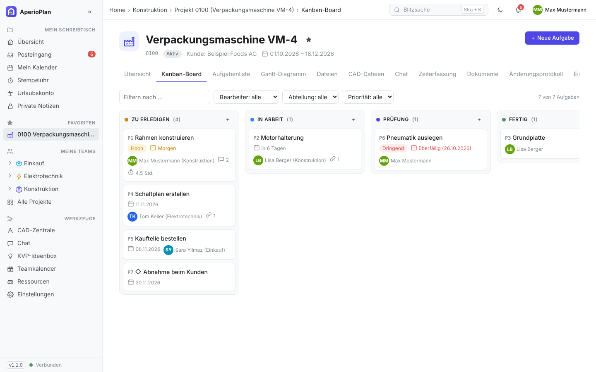
</p>

Der Name kommt vom lateinischen *aperio* – „ich öffne, mache sichtbar“. AperioPlan bringt alles, was in einem Projekt passiert, an einen Ort: Aufgaben und Termine, Dateien und CAD-Daten, Zeiten und Urlaub, Gespräche und Ideen. Es läuft auf dem eigenen Server der Firma, auf einer virtuellen Maschine oder auf einem kleinen Rechner wie dem Raspberry Pi. Die Daten verlassen das Haus nicht.

---

## Inhalt

* [Was AperioPlan kann](#was-aperioplan-kann)
* [Bildschirmfotos](#bildschirmfotos)
* [Installation](#installation)
* [Verschlüsselte Verbindung (HTTPS)](#verschlüsselte-verbindung-https)
* [Bedienung im Alltag](#bedienung-im-alltag)
* [Aktualisieren](#aktualisieren)
* [Deinstallieren](#deinstallieren)
* [Handbücher](#handbücher)
* [Für Entwickler](#für-entwickler)

---

## Was AperioPlan kann

| Bereich | Das steckt drin |
|---|---|
| **Projekte** | Automatische Projektnummern (z. B. `0100`, Teilprojekte `0100-A`), Ordnerstruktur, Symbol und Farbe je Projekt, Favoriten, Teams und Abteilungen |
| **Aufgaben** | Kanban-Board, Aufgabenliste, Gantt-Diagramm mit Abhängigkeiten und Meilensteinen, Kommentare mit @Erwähnungen, Whiteboard, Abschlussbericht |
| **Dateien** | Versionen statt Überschreiben, Sperren, Vorschau, Netzlaufwerk (NAS), Freigabelinks für Kunden und Lieferanten, Office im Browser |
| **CAD-Zentrale** | SolidWorks-Anbindung, Nummern wie `0100-100-00-0000-00`, Speichermaske, Aus- und Einchecken, Versionsstände, Stücklisten, „Wo verbaut?“, Freigabe mit PDF/DXF/STEP |
| **Ressourcen** | Räume, Firmenwagen und Geräte buchen – ohne Doppelbuchungen, mit Genehmigung, Serienterminen und Vorschlägen für freie Alternativen |
| **Zeit und Urlaub** | Stempeluhr, Korrekturanfragen, Urlaubskonto mit Feiertagen aller Bundesländer, Teamkalender, der nur „abwesend“ zeigt |
| **Kommunikation** | Chat für Projekte und Teams, Videoanrufe mit Bildschirmfreigabe, E-Mail-Postfach mit automatischer Projektzuordnung |
| **Verbesserung** | KVP-Ideenbox mit Einsparpotenzial und Entscheidung, KI-Assistent (lokal oder extern) |
| **Betrieb** | Verschlüsselte Nacht-Sicherung, Wiederherstellung mit Duplikaterkennung, Ein-Klick-Aktualisierung, revisionssicheres Änderungsprotokoll, Firmen-Login (Active Directory) |
| **Komfort** | Strg + K-Blitzsuche, Hell- und Dunkelmodus, eigener Symbolsatz, Smartphone-tauglich, Erweiterungen (Plugins) und Webhooks |

## Bildschirmfotos

Alle Bilder zeigen erfundene Beispieldaten.

| | |
|---|---|
| 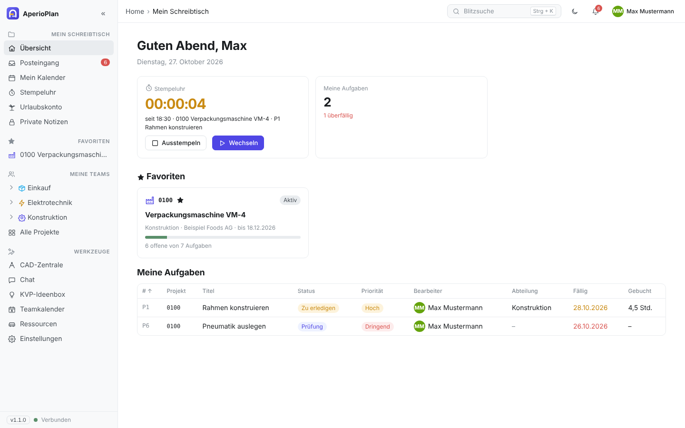 **Mein Schreibtisch** – Stempeluhr, eigene Aufgaben und Favoriten auf einen Blick | 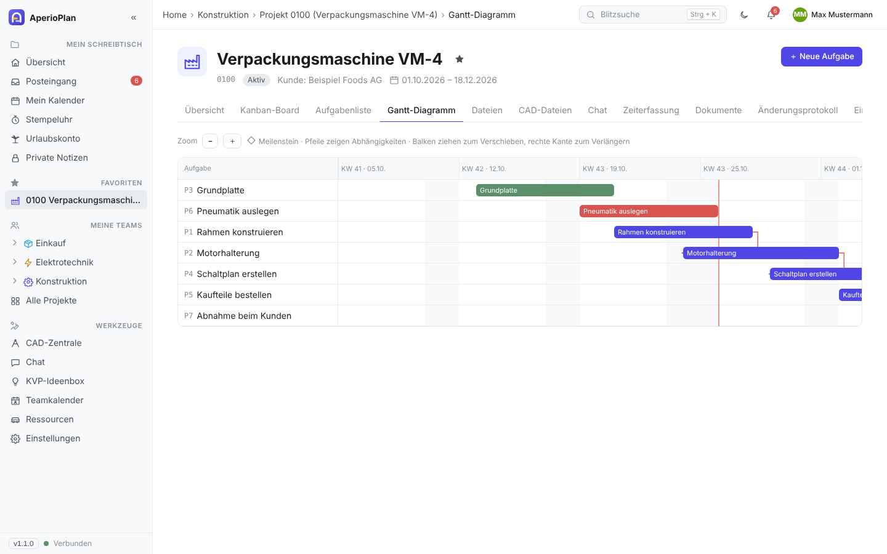 **Gantt-Diagramm** – Balken ziehen verschiebt Termine, Pfeile zeigen Abhängigkeiten |
| 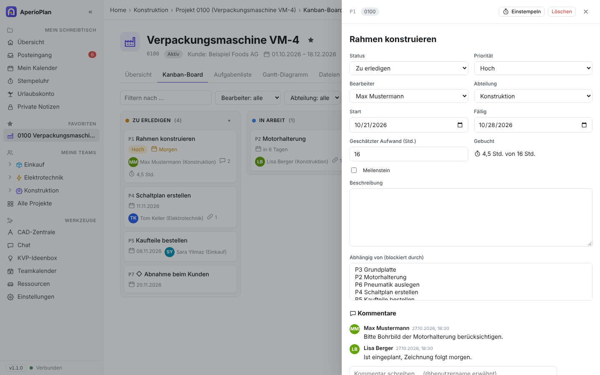 **Aufgabe** – alle Details in einem Fenster von rechts, mit Kommentaren und Verlauf | 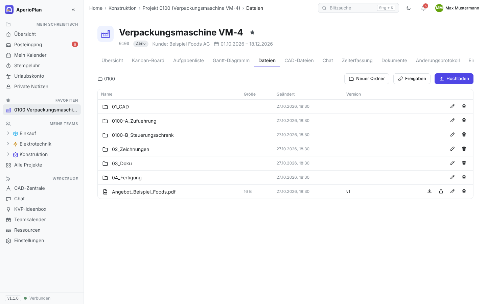 **Dateien** – Versionen, Sperren und Freigaben für Externe |
| 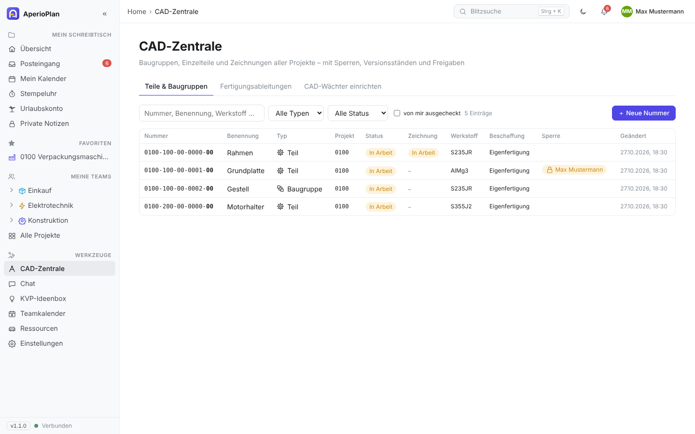 **CAD-Zentrale** – alle Teile und Baugruppen mit Status und Sperren | 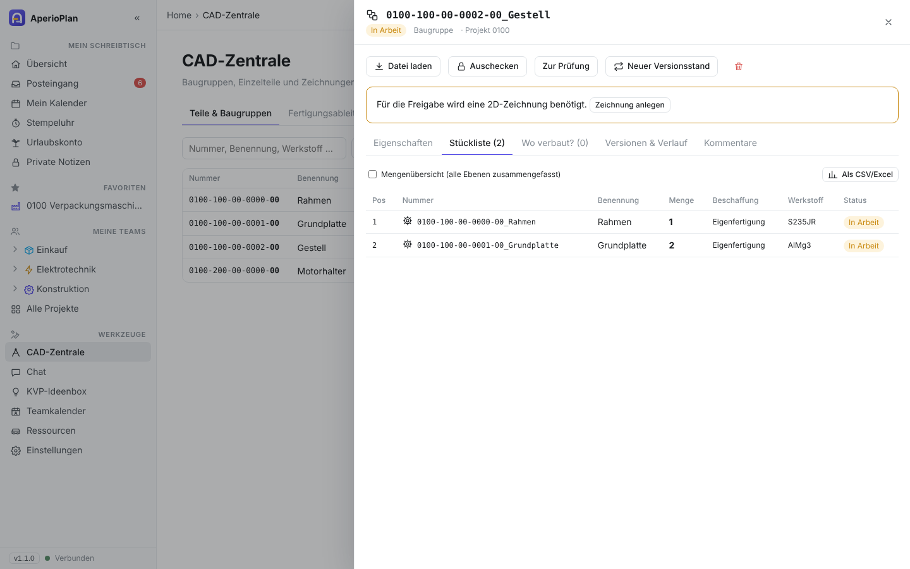 **Stückliste** – direkt aus SolidWorks übernommen, als Excel exportierbar |
| 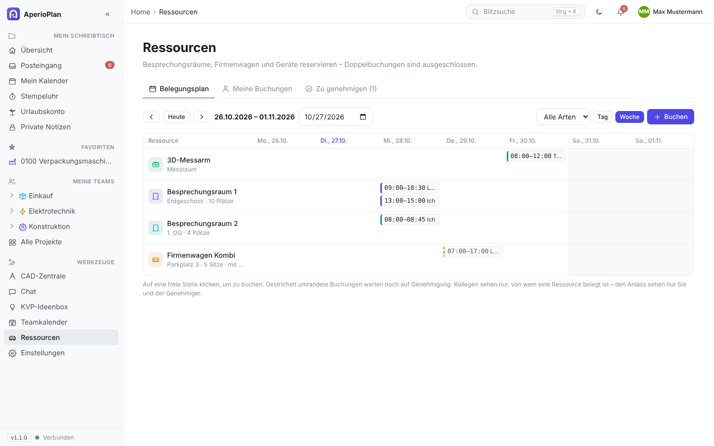 **Ressourcen** – Belegungsplan für Räume, Fahrzeuge und Geräte | 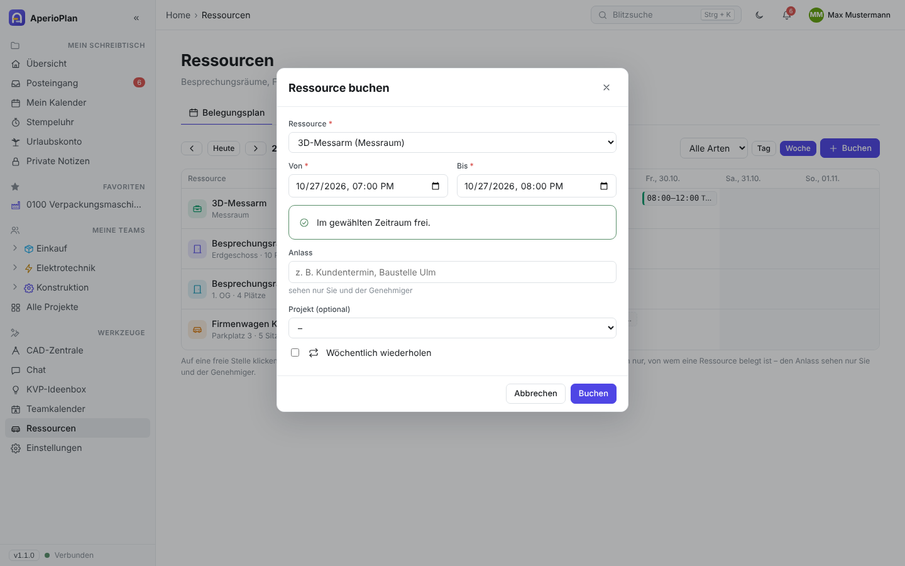 **Buchen** – zeigt sofort, ob frei ist, und schlägt Alternativen vor |
| 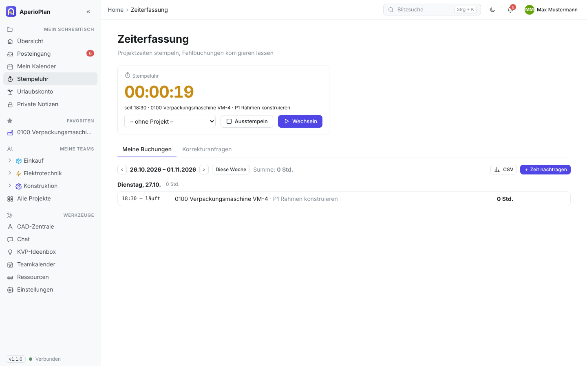 **Zeiterfassung** – Stempeluhr und Wochenübersicht | 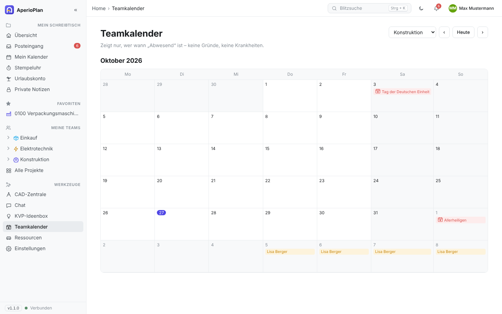 **Teamkalender** – wer wann da ist, ohne Gründe zu verraten |
| 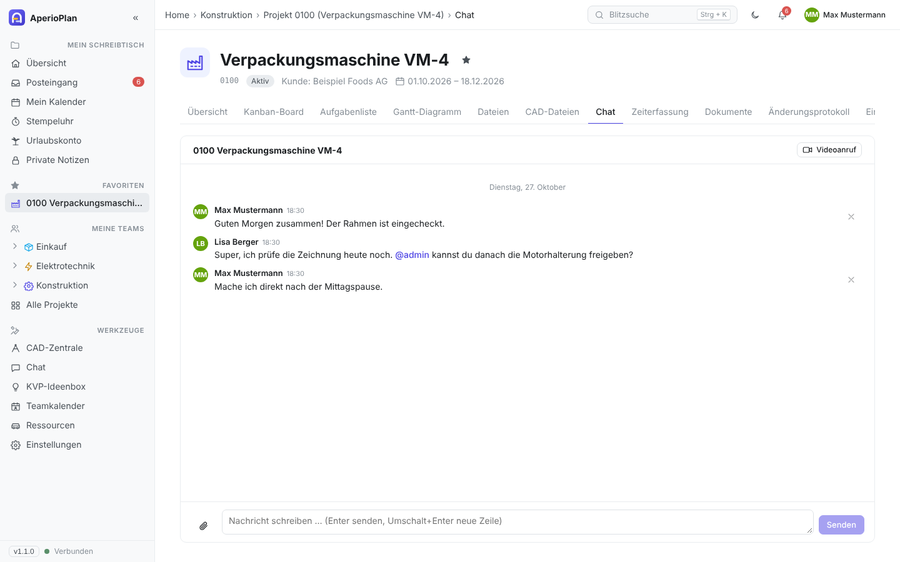 **Projekt-Chat** – mit Anhängen, Erwähnungen und Videoanruf | 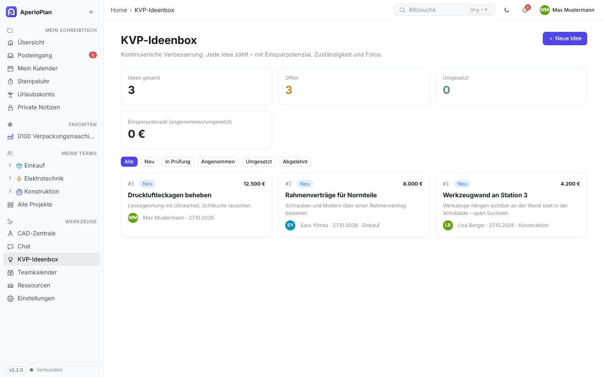 **KVP-Ideenbox** – Verbesserungsvorschläge mit Einsparpotenzial |
| 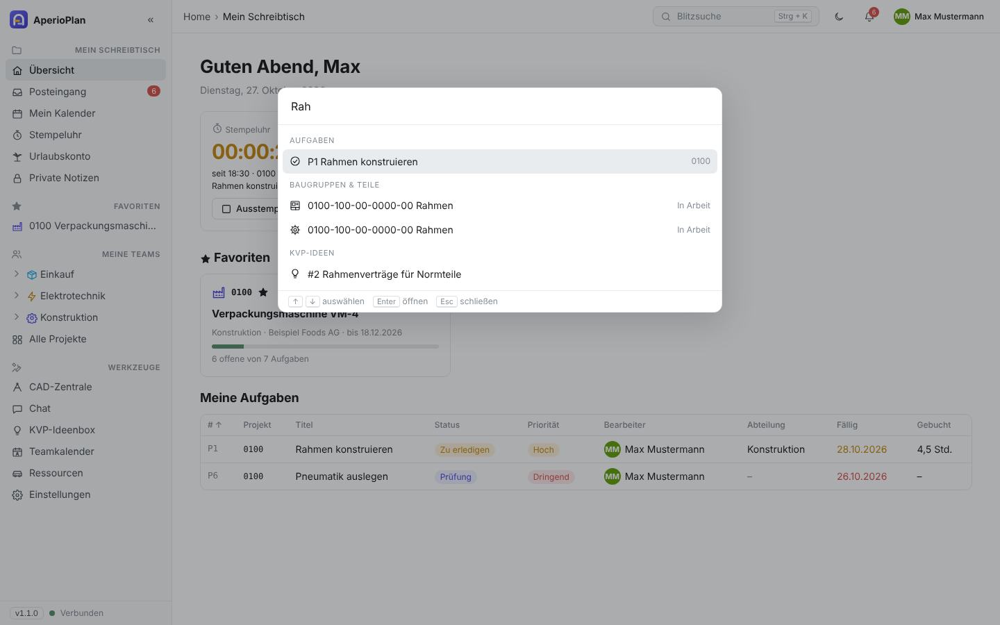 **Blitzsuche** – Strg + K findet Projekte, Teile, Aufgaben, Dateien und Kollegen | 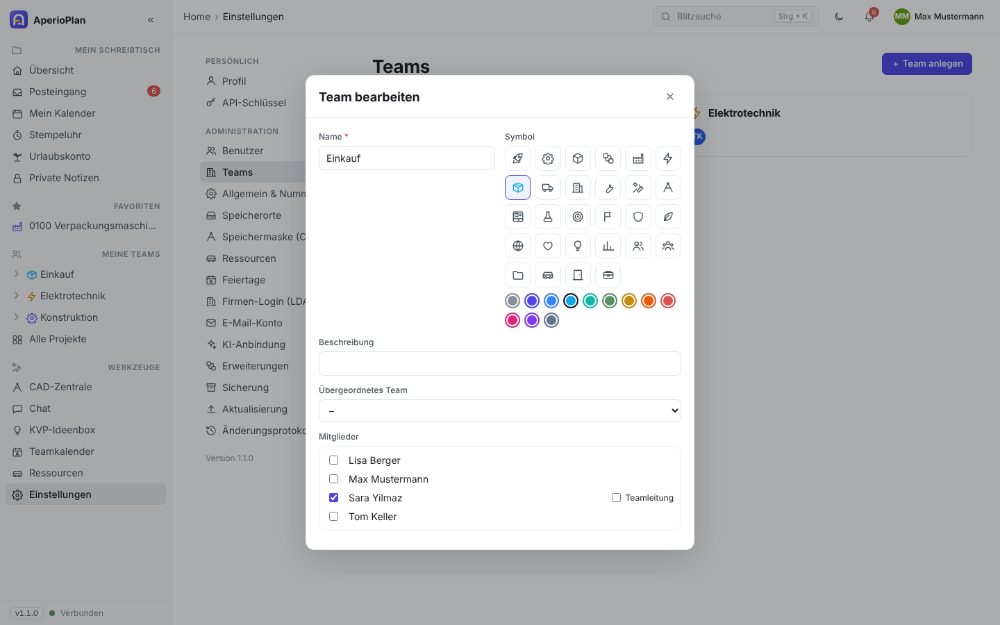 **Symbol und Farbe** – für jedes Projekt und Team |
| 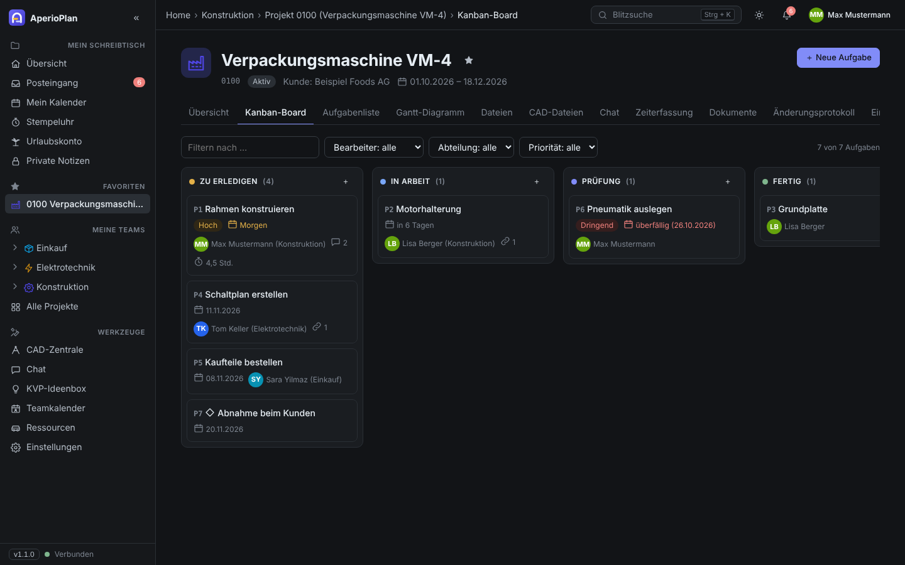 **Dunkelmodus** – folgt auf Wunsch automatisch dem Betriebssystem | 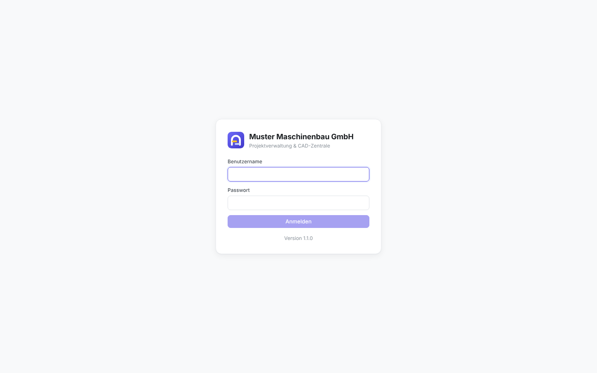 **Anmeldung** – mit Firmenname, auf Wunsch über Active Directory |

## Installation

**Sie brauchen:** einen Rechner mit Debian, Ubuntu oder Raspberry Pi OS (eigener Server, Cloud-Server, virtuelle Maschine oder Proxmox-Container), 2 GB Arbeitsspeicher oder mehr und Internet für die Installation.

**Ein Befehl genügt:**

```sh
curl -fsSL https://raw.githubusercontent.com/loe17/AperioPlan/main/install.sh | sudo bash
```

oder Schritt für Schritt:

```sh
sudo git clone https://github.com/loe17/AperioPlan.git /opt/aperioplan
cd /opt/aperioplan
sudo ./install.sh
```

Das Installationsskript fragt alles Nötige ab und erklärt jeden Schritt:

1. **Prüft das System** – Administratorrechte, Betriebssystem, virtuelle Maschine oder Container.
2. **Installiert fehlende Programme** – nach Rückfrage, z. B. Docker.
3. **Erzeugt die Zugangsschlüssel** – Datenbank-Passwort und Sicherungsschlüssel.
4. **Fragt, wie AperioPlan erreichbar sein soll** – im lokalen Netz oder über eine Internet-Adresse (siehe nächster Abschnitt).
5. **Startet alles** und prüft, ob AperioPlan antwortet.
6. **Zeigt eine Übersicht** mit allen Adressen und dem Sicherungsschlüssel.

```
====================================================================
               AperioPlan erfolgreich gestartet!
====================================================================
Die Web-Oberfläche ist unter folgenden Adressen erreichbar:
  -> Im lokalen Netz (mDNS):
     https://aperioplan.local
  -> Über die Server-IP:
     https://192.168.1.20

Erste Anmeldung:  Benutzer admin / Passwort admin (wird sofort geändert)
```

Danach im Browser die angezeigte Adresse öffnen, mit **admin / admin** anmelden und ein eigenes Passwort vergeben.

> **Wichtig:** Den angezeigten **BACKUP_KEY** sicher aufbewahren (ausdrucken oder im Passwort-Tresor). Ohne ihn lassen sich Sicherungen nicht wiederherstellen. Er steht auch in der Datei `.env` im Programmordner.

Die Installation kann jederzeit wiederholt werden, etwa um die Adresse zu ändern: `sudo ./install.sh`.

## Verschlüsselte Verbindung (HTTPS)

AperioPlan wird **immer verschlüsselt** aufgerufen – ob im Internet oder nur im Firmennetz. Bei der Installation stehen drei Wege zur Wahl:

| Weg | Adresse | Zertifikat | Gut für |
|---|---|---|---|
| **1 – Lokales Netz** | `https://aperioplan.local`, `https://<Server-IP>` | eigenes AperioPlan-Zertifikat | schnell starten, kein Konto nötig |
| **2 – Lokales Netz mit eigener Domain** | z. B. `https://musterfirma.duckdns.org` | **Let's Encrypt** | Firmennetz ohne Browser-Warnung, Server bleibt unsichtbar fürs Internet |
| **3 – Internet-Domain** | z. B. `https://plan.firma.de` | **Let's Encrypt** | Zugriff von unterwegs |

**Warum gibt es Weg 1 überhaupt?** Let's Encrypt stellt nur Zertifikate für Namen aus, die im Internet eindeutig sind. Für `aperioplan.local` oder `192.168.1.20` ist das nicht möglich. Bei Weg 1 erzeugt AperioPlan deshalb ein eigenes Zertifikat. Damit der Browser nicht warnt, wird es einmal pro Rechner hinterlegt – die Datei gibt es unter `http://aperioplan.local/zertifikat.crt`.

**Weg 2** verbindet das Beste aus beiden: Eine eigene (auch kostenlose) Domain zeigt auf die interne Adresse, und Let's Encrypt prüft über den DNS-Anbieter, dass sie Ihnen gehört. Unterstützt werden DuckDNS (kostenlos), Cloudflare, Hetzner und IONOS.

Bei Weg 2 und 3 holt AperioPlan das Zertifikat automatisch und erneuert es vor Ablauf. Einzelheiten im [Administrator-Handbuch, Abschnitt 4](docs/ADMINISTRATOR.md#4-erreichbarkeit-und-https-zertifikat).

## Bedienung im Alltag

* **Seitenleiste links:** Schreibtisch, Teams mit ihren Projekten und alle Werkzeuge.
* **Strg + K** öffnet die Blitzsuche – zwei Buchstaben genügen.
* **Ein Klick** auf eine Aufgabe, ein Teil oder eine Buchung öffnet rechts die Details.
* **Version unten links** – ein Klick zeigt, was neu ist.

Die ausführliche Anleitung für alle Mitarbeiter steht im [Anwender-Handbuch](docs/ANWENDER.md).

## Aktualisieren

**Einstellungen → Aktualisierung → Prüfen → Jetzt aktualisieren.** Vorher wird automatisch eine Sicherung erstellt; Daten, Dateien und Einstellungen bleiben erhalten.

Von Hand im Programmordner:

```sh
sudo git pull && sudo docker compose up -d --build
```

> **Von 1.0 auf 1.1:** Nach der Aktualisierung einmal `sudo ./install.sh` ausführen und die vorhandene `.env` behalten. Dabei wird die neue, immer verschlüsselte Verbindung eingerichtet.

## Deinstallieren

AperioPlan lässt sich mit einem Skript vollständig wieder entfernen:

```sh
cd /opt/aperioplan        # bzw. Ihr Programmordner
sudo ./uninstall.sh
```

Das Skript

1. **bietet eine Abschlusssicherung an** – Datenbank, Projektdateien, vorhandene Sicherungen und Einstellungen werden in Ihren Benutzerordner kopiert (`aperioplan-abschluss-<Datum>`),
2. **fragt zur Sicherheit nach der Eingabe `LÖSCHEN`**,
3. **entfernt** alle AperioPlan-Dienste, die Datenbank, die Zertifikate, die Programmabbilder, den Dienst für `aperioplan.local` und den Programmordner,
4. **fragt gesondert**, ob Ordner auf einem Netzlaufwerk (Projektdateien, Sicherungen) gelöscht werden sollen – Standard: nein,
5. **fragt zum Schluss**, ob auch Docker selbst entfernt werden soll – Standard: nein, weil oft andere Programme Docker nutzen.

Für Testsysteme ohne Rückfragen: `sudo ./uninstall.sh --ja` (legt die Abschlusssicherung an, lässt Netzlaufwerke und Docker in Ruhe).

## Handbücher

* [Administrator-Handbuch](docs/ADMINISTRATOR.md) – Installation, HTTPS, Netzlaufwerk, Firmen-Login, Ressourcen, Sicherung, Aktualisierung, Deinstallation
* [Anwender-Handbuch](docs/ANWENDER.md) – Projekte, Aufgaben, Dateien, CAD, Ressourcen buchen, Zeiten, Urlaub, Chat
* [Entwickler-Handbuch](docs/ENTWICKLER.md) – Schnittstelle (REST-API), Echtzeit, Symbole, Plugins, Webhooks
* [CAD-Wächter](cad-bridge/README.md) – SolidWorks-Add-in, Export-Dienst, Kommandozeile
* [Testplan und Ergebnisse](docs/TESTPLAN.md)

## Für Entwickler

| Bereich | Technik |
|---|---|
| Web-Oberfläche | TypeScript, React, Vite |
| Server | TypeScript, Node.js, Fastify |
| Datenbank | PostgreSQL |
| CAD-Wächter (SolidWorks) | C# / .NET |
| Bereitstellung | Docker Compose, Caddy (HTTPS), Autoheal |

```sh
corepack enable
pnpm install
pnpm dev                                    # Server :3000 und Oberfläche :5173
pnpm test                                   # Server-Tests (Datenbank aperio_test)
node e2e/testplan.mjs                       # Browser-Test auf frischer Instanz
node e2e/screenshots.mjs                    # Bildschirmfotos neu erzeugen
```

```
shared/      gemeinsame Fachlogik (Nummern, Status, Versionsprotokoll)
server/      Server (REST-API, Echtzeit, Sicherung, Planer)
web/         Web-Oberfläche
cad-bridge/  CAD-Wächter für SolidWorks (C#)
deploy/      Webserver-Vorlage, DNS-Erweiterung, Updater
docs/        Handbücher, Logo, Bildschirmfotos
```
