# AperioPlan – Handbuch für Anwender

Willkommen bei AperioPlan! Diese Anleitung zeigt Schritt für Schritt, wie Sie im Alltag mit Projekten, Aufgaben, CAD-Daten, Zeiten und Urlaub arbeiten – und was die Apps aus dem App-Store können.

> **Welche Werkzeuge Sie sehen, legt Ihre Firma fest.** Jedes Werkzeug ist eine App, die der Administrator im App-Store einschaltet. Fehlt etwas in Ihrer Seitenleiste, ist die App nicht installiert oder für Sie nicht freigegeben.

---

## 1. Anmelden und erste Schritte

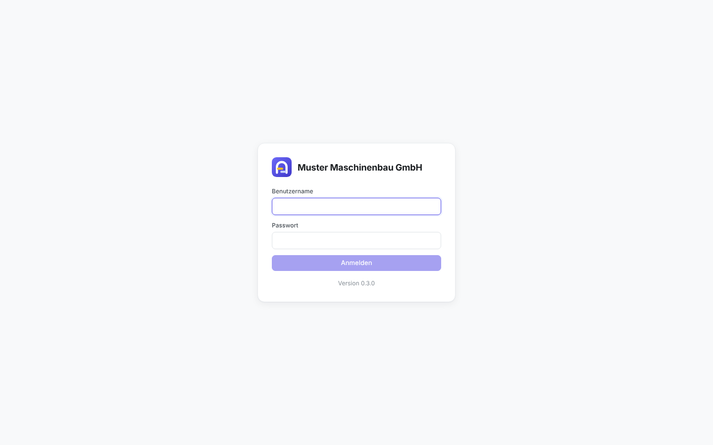

1. Im Browser die Adresse Ihrer Firma öffnen (z. B. `https://plan.firma.de` oder `https://aperioplan.local`). Warnt der Browser vor dem Zertifikat, hat Ihr Rechner das AperioPlan-Zertifikat noch nicht – Ihre IT richtet das einmalig ein (Administrator-Handbuch, Abschnitt 4).
2. Mit Benutzername und Passwort anmelden – bei eingerichtetem Firmen-Login mit Ihren gewohnten Windows-Zugangsdaten.
3. Beim ersten Mal vergeben Sie ein eigenes Passwort (mindestens 8 Zeichen).

Unter **Einstellungen → Profil** stellen Sie Sprache (Deutsch/Englisch) und Farbschema ein. „Wie System“ folgt automatisch dem Hell-/Dunkelmodus von Windows.

## 2. Die Oberfläche

```
┌────────────────────┬──────────────────────────────────────────────────────┐
│ Seitenleiste       │ Brotkrumen-Pfad        Blitzsuche   Glocke   Profil  │
│  Mein Schreibtisch ├──────────────────────────────────────────────────────┤
│  Favoriten         │                                                      │
│  Meine Teams       │                 Arbeitsbereich                       │
│  Werkzeuge         │                                                      │
│  App-Store         │                                                      │
│  Einstellungen     │                                                      │
│ v0.3.0 ● Verbunden │                                                      │
└────────────────────┴──────────────────────────────────────────────────────┘
```

* **Seitenleiste:** Schnellzugriff auf Ihren Schreibtisch, Ihre Teams mit Projekten und die Werkzeuge. Ein Klick auf eine Überschrift (z. B. **Werkzeuge**, **Favoriten**, **Meine Teams**) klappt den Abschnitt ein oder aus – AperioPlan merkt sich das. App-Store und Einstellungen stehen getrennt ganz unten. Mit `«` oder **Strg + \\** klappen Sie die ganze Leiste ein, mit dem Menü-Symbol wieder auf.
* **Brotkrumen-Pfad:** zeigt immer, wo Sie gerade sind – jeder Teil ist anklickbar.
* **Blitzsuche – Strg + K:** zwei Buchstaben genügen, um zu einem Projekt, einer Baugruppe, einer Aufgabe, Datei oder einem Kollegen zu springen. Mit Pfeiltasten auswählen, Enter öffnet.
* **Glocke:** neue Aufgaben, Erwähnungen, Freigaben und Genehmigungen.
* **Detail-Fenster:** Ein Klick auf eine Aufgabe, ein Bauteil oder eine Idee öffnet rechts eine Karte mit allen Details. Klick daneben oder `Esc` schließt sie.
* **Version unten links:** Ein Klick zeigt „Was ist neu?“.

## 3. Mein Schreibtisch

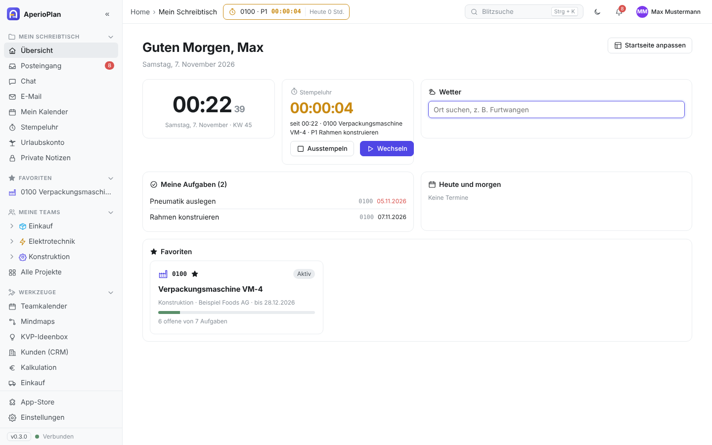

* **Übersicht:** Begrüßung, Stempeluhr, Ihre offenen Aufgaben, Favoriten.
* **Posteingang:** alle Benachrichtigungen.
* **Chat** und **E-Mail:** Ihre Unterhaltungen und Ihr Postfach.
* **Mein Kalender:** Fristen Ihrer Aufgaben, eigene Abwesenheiten, Feiertage.
* **Stempeluhr, Urlaubskonto, Private Notizen** (nur für Sie sichtbar).

Projekte markieren Sie mit dem Stern neben dem Namen als Favorit.

## 4. Projekte

### Projekt anlegen

**Alle Projekte → Neues Projekt** (oder Strg + K → „Neues Projekt“).

* Die **Projektnummer** wird automatisch vergeben (z. B. `0100`).
* Als **Teilprojekt** eines Hauptprojekts erhält es einen Buchstaben (`0100-A`).
* Der Projektordner mit `01_CAD`, `02_Zeichnungen`, `03_Doku`, `04_Fertigung` wird automatisch angelegt.
* Unter **Symbol** wählen Sie ein Bild und eine Farbe für das Projekt – so finden Sie es in Listen und der Seitenleiste schneller wieder. Teams erhalten ihr Symbol unter **Einstellungen → Teams**.

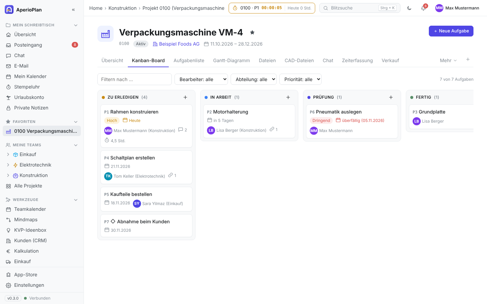

### Werkzeuge im Projekt (Reiter)

| Reiter | Wofür |
|---|---|
| Übersicht | Fortschritt, überfällige Aufgaben, Teilprojekte, nächste Fristen |
| Kanban-Board | Aufgaben per Maus zwischen *Zu erledigen*, *In Arbeit*, *Prüfung*, *Fertig* verschieben |
| Aufgabenliste | Tabelle mit Filtern und Sortierung |
| Gantt-Diagramm | Zeitbalken mit Meilensteinen ◆ und Abhängigkeiten (Pfeile). Balken ziehen verschiebt, rechte Kante verlängert |
| Whiteboard | freie Zeichenfläche: Haftnotizen, Formen, Pfeile, Freihand – Doppelklick bearbeitet Text, Mausrad zoomt |
| Dateien | Projektordner mit Hochladen, Versionen und Freigaben |
| CAD-Dateien | alle Teile, Baugruppen und Zeichnungen des Projekts |
| Chat | Projekt-Chat mit Videoanruf |
| Zeiterfassung | Stempeluhr für das Projekt, Auswertung nach Mitarbeiter und Aufgabe |
| Abschlussbericht | Ziele, Ergebnis, Kosten, Abnahme – druckbar |
| Dokumente | Schriftverkehr, Verträge, Berichte mit Nummer (`0100-DOK-001`) |
| Änderungsprotokoll | Wer hat wann was geändert? |

### Apps im Projekt

Viele Apps aus dem App-Store haben zusätzlich einen eigenen Reiter im Projekt. Dort sehen Sie **nur die Einträge dieses Projekts**, legen neue an (das Projekt ist schon eingetragen), ändern den Status und verfolgen den Stand. Die **Gesamtübersicht über alle Projekte** bleibt links unter **Werkzeuge** – dort lassen sich die Listen mit **nach Projekt gruppieren** nach Projekten ordnen.

| Reiter | App | Was Sie im Projekt sehen und tun |
|---|---|---|
| Einkauf | Einkauf | Bestellpositionen mit Status, Liefertermin, Wareneingang und Verlauf |
| Verkauf | Kunden (CRM) | Angebote, Rechnungen, Verkaufschancen und Reklamationen zum Projekt. Die Kontakte bleiben im CRM |
| Material | Lager | was für das Projekt aus dem Lager entnommen oder zurückgegeben wurde |
| Service | Service-Einsätze | Montage, Inbetriebnahme und Service beim Kunden |
| Qualität | Qualität | Prüfungen und 8D-Reports |
| Fertigung | Fertigung | Fertigungsaufträge |
| Änderungen | Änderungsmanagement | Änderungsanträge |
| Reisekosten | Spesen | Abrechnungen zum Projekt (Projektleitung sieht alle, sonst die eigenen) |
| Freigaben | Freigaben | Anträge zum Projekt, z. B. Anschaffungen |
| Unterschriften | E-Signatur | Dokumente des Projekts zur Unterschrift |
| CO₂ | Nachhaltigkeit | Emissionen des Projekts |
| Eingangsrechnungen | Finanzbuchhaltung | Lieferantenrechnungen zum Projekt |
| Ressourcen | Ressourcen | gebuchte Fahrzeuge, Räume und Geräte |
| Meetings | Meetings | Besprechungen zum Projekt |
| Mindmaps | Mindmaps | Mindmaps des Projekts |

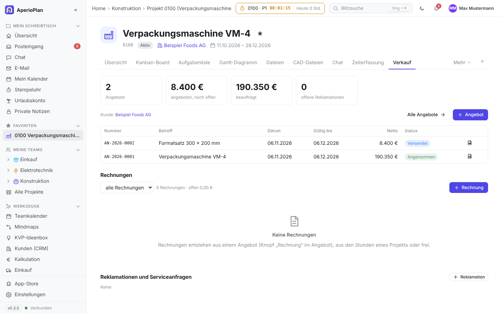

Reiter erscheinen nur für Apps, die bei Ihnen installiert sind und die Sie benutzen dürfen. **Weitere Reiter einblenden:** Projektverantwortliche klicken auf **＋** am Ende der Reiterleiste und wählen die App. Welche Reiter ein Projekt hat und in welcher Reihenfolge, steht unter **Einstellungen** im Projekt.

### Aufgaben

* **Neue Aufgabe** oben rechts oder `＋` in einer Kanban-Spalte.
* Im Detail-Fenster: Status, Priorität, Bearbeiter, Abteilung, Start/Fällig, geschätzter Aufwand, Meilenstein, Beschreibung, Abhängigkeiten.
* **Kommentare:** Mit `@benutzername` erwähnen Sie Kollegen – sie werden benachrichtigt. Strg + Enter sendet.
* **Einstempeln** im Detail-Fenster bucht Ihre Zeit direkt auf diese Aufgabe.

## 5. Dateien

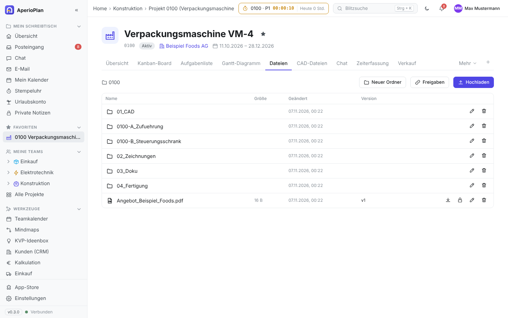

* **Hochladen:** Dateien einfach in das Fenster ziehen oder „Hochladen“ wählen. Gleichnamige Dateien werden nicht überschrieben, sondern als neue **Version** gespeichert (v2, v3 …) – ältere Stände bleiben abrufbar.
* **Vorschau:** PDFs, Bilder und Videos öffnen sich direkt im Browser.
* **3D-Dateien** öffnen sich mit einem Klick **im selben Fenster** (wie Word-Dateien); **Zurück** führt in den Ordner. Siehe [3D-Ansicht](#5a-3d-ansicht).
* **Sperren (Schloss):** verhindert, dass Kollegen eine Datei gleichzeitig bearbeiten.
* **Office (Bearbeiten-Knopf):** Word-, Excel- und PowerPoint-Dateien im Browser bearbeiten (falls eingerichtet).
* Gelöschte Dateien landen im Papierkorb des Projekts.
* Der Pfad für den **Windows-Explorer** steht oberhalb der Liste.

### Freigaben für Externe (Knopf „Freigaben“)

| Art | Wofür |
|---|---|
| Daten teilen | Kunden/Lieferanten laden Dateien eines Ordners herunter |
| Daten anfordern | Lieferanten laden große 3D-Dateien oder Datenblätter **ohne Benutzerkonto** direkt in einen Projektordner hoch |
| Gastzugang | Kunden, Statiker oder Partner sehen nur die freigegebenen Bereiche (Dateien, freigegebene Zeichnungen, Termine) |

Jeder Link kann ein **Passwort**, ein **Ablaufdatum** und eine **maximale Anzahl Nutzungen** erhalten und jederzeit widerrufen werden. Bei Uploads über einen Anforderungslink werden Sie benachrichtigt.

## 5a. 3D-Ansicht

Ein Klick auf eine 3D-Datei im Projektordner, in der CAD-Zentrale (**3D ansehen**), bei Dokumenten oder E-Mail-Anhängen öffnet die 3D-Ansicht im ganzen Fenster:

* **Drehen** mit der linken Maustaste, **Verschieben** mit der rechten, **Zoomen** mit dem Mausrad.
* **Iso, Vorne, Oben, Rechts** und **Einpassen** wechseln die Ansicht.
* **Schnitt X/Y/Z** schneidet das Modell auf, der Schieberegler verschiebt die Schnittebene.
* **Messen:** zwei Punkte anklicken – Abstand und Maße in X, Y und Z in Millimetern.
* **Baugruppe:** Teile im Baum ein- und ausblenden, Doppelklick zeigt nur dieses Teil; **Explosion** zieht Baugruppen auseinander.
* Das Bild-Symbol speichert die aktuelle Ansicht als PNG.

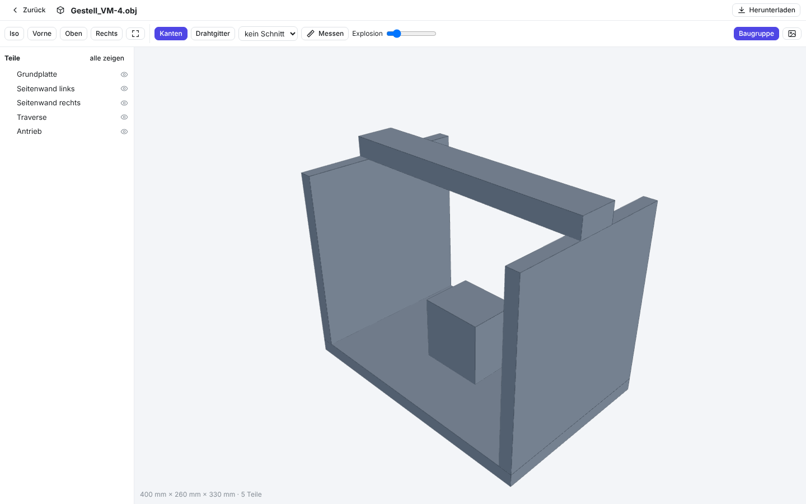

**Direkt angezeigt** werden STEP, IGES, BREP, STL, OBJ, glTF/GLB, 3MF, PLY, FBX, Collada (DAE), VRML (WRL), AMF, 3DS, VTK und USDZ.

**Native CAD-Dateien** (SolidWorks `.sldprt`/`.sldasm`, Inventor `.ipt`/`.iam`, Solid Edge `.par`/`.psm`/`.asm`, CATIA `.CATPart`/`.CATProduct`, Creo und NX `.prt`, Parasolid, ACIS, JT) kann nur das jeweilige CAD-Programm lesen. AperioPlan zeigt sofort das **Vorschaubild**, das das Programm in der Datei gespeichert hat. Gleichzeitig wird die Datei zur Umwandlung vorgemerkt: Ein Rechner mit dem CAD-Programm (Umwandlungsdienst, richtet Ihr Administrator ein) macht daraus einmalig ein STEP-Modell – danach lässt sie sich wie oben drehen, schneiden und messen. Für Creo und NX gibt es noch keine Umwandlung, dort bleibt es beim Vorschaubild.

## 6. CAD-Zentrale (SolidWorks)

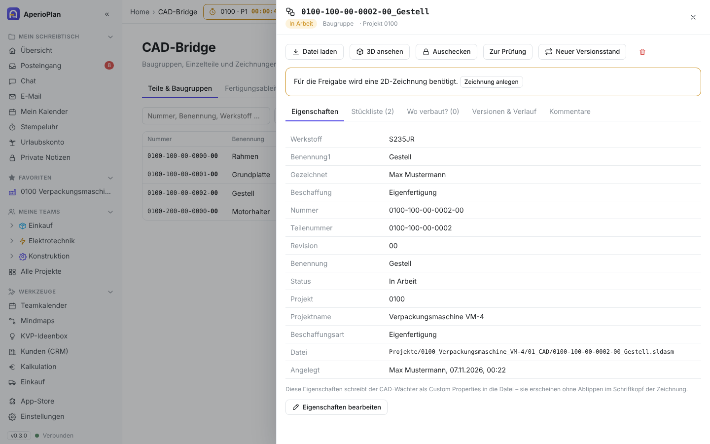

### Nummern verstehen

`0100-100-00-0000-00_Rahmen`

| Teil | Bedeutung |
|---|---|
| `0100` | Hauptbaugruppe = Projektnummer |
| `100` | Unterbaugruppe (z. B. 100 Gestell, 200 Antrieb, 300 Pneumatik) |
| `00` | Unter-Unterbaugruppe |
| `0000` | laufende Teilenummer |
| `00` | Versionsstand (00 = Urversion, 01 = erste Überarbeitung) |
| `_Rahmen` | sprechende Benennung |

### In SolidWorks speichern

1. Neues Teil/Baugruppe konstruieren und **Speichern** drücken.
2. Die **Speichermaske** öffnet sich: Projekt, Unterbaugruppe, Benennung, Werkstoff, Beschaffungsart … ausfüllen. Pflichtfelder sind mit * markiert; die Vorschau zeigt den künftigen Dateinamen.
3. Auf Wunsch wird die **passende 2D-Zeichnung** (`.slddrw`) gleich mit angelegt.
4. Alle Eingaben stehen danach als Eigenschaften in der Datei – und damit **ohne Abtippen im Schriftkopf** der Zeichnung.

### Auschecken und Einchecken

* Eine Datei, die Sie bearbeiten, ist für andere **gesperrt** („Gesperrt durch Max Mustermann“). Kollegen können sie in Baugruppen laden und ansehen, aber nicht überschreiben.
* Menü **AperioPlan → Einchecken …**: Datei mit kurzem Kommentar hochladen. Bei Baugruppen wird die Stückliste automatisch übertragen.
* **Strg + S** auf einer nicht ausgecheckten Datei: Der Wächter bietet das Auschecken an.

### Änderungen: Neuer Versionsstand

Freigegebene Teile sind schreibgeschützt. Für Änderungen **AperioPlan → Neuer Versionsstand**: Grund eingeben (z. B. *„Bohrungsdurchmesser auf 12 mm vergrößert wegen stärkerer Welle“*). Aus `…-00` wird `…-01`. Jeder Stand bleibt für immer abrufbar.

### Wo verbaut?

Vor dem Ändern oder Löschen zeigt **Wo verbaut?** alle Baugruppen und Projekte, die das Teil verwenden.

### Freigabe

1. Konstrukteur: **Zur Prüfung geben**.
2. Teamleitung/Projektverantwortliche prüfen und **freigeben**.
3. Ein Eigenfertigungsteil kann erst freigegeben werden, wenn seine **Zeichnung freigegeben** ist.
4. Nach der Freigabe entstehen automatisch **PDF** (Werkstatt, Einkauf), **DXF** (Laser/Brennschneiden) und **STEP** (CNC) im Ordner `04_Fertigung`.

### Stückliste

Im Detail-Fenster einer Baugruppe: **Stückliste** – mehrstufig oder als Mengenübersicht, Export als CSV für Excel.

> Ohne SolidWorks können Nummern auch im Browser vergeben werden: **CAD-Zentrale → Neue Nummer**.

## 7. Zeiterfassung

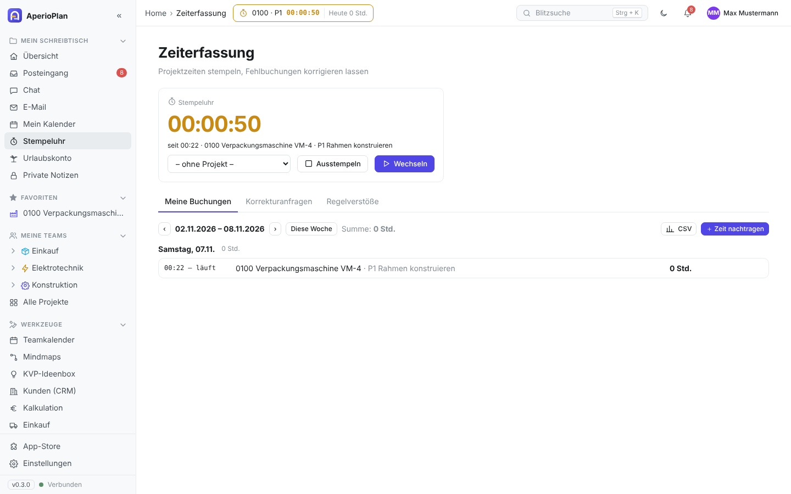

* **Einstempeln:** Stempeluhr auf dem Schreibtisch, unter **Stempeluhr** oder direkt in einer Aufgabe. Ein erneutes Einstempeln auf ein anderes Projekt **wechselt** automatisch.
* **Ausstempeln** beendet die Buchung.
* **Fehlbuchung?** Bei der Buchung **Korrektur …** wählen (oder „Zeit nachtragen“): *Was? Welche Zeit? Warum?* angeben. Die Teamleitung genehmigt mit einem Klick, Sie werden benachrichtigt.
* Wochenübersicht mit Summen, Export als CSV.

## 8. Urlaub und Abwesenheit

1. **Urlaubskonto → Urlaub beantragen**: ersten und letzten Tag wählen, ggf. halbe Tage. AperioPlan rechnet Wochenenden und Feiertage heraus und zeigt die Arbeitstage.
2. Die Teamleitung erhält den Antrag und genehmigt ihn.
3. Das Konto zeigt Anspruch, genommene, beantragte und verbleibende Tage.

**Datenschutz:** Im **Teamkalender** sehen Kollegen nur, *wann* Sie abwesend sind – niemals Urlaub, Krankheit oder Ihre Notiz.

## 8a. Räume, Fahrzeuge und Geräte buchen

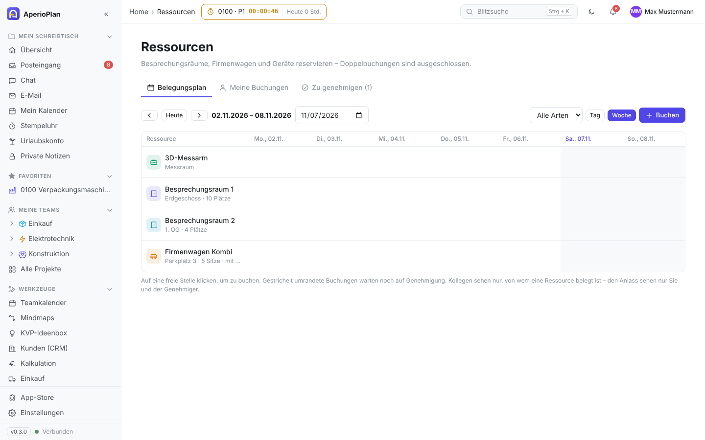

**Werkzeuge → Ressourcen** zeigt den Belegungsplan aller Räume, Firmenwagen und Geräte – als Woche (alle Ressourcen nebeneinander) oder als Tag mit Uhrzeiten.

1. Auf eine freie Stelle im Plan klicken oder **Buchen** wählen.
2. Ressource, Beginn und Ende auswählen. AperioPlan zeigt sofort, ob der Zeitraum frei ist. Ist er belegt, schlägt es freie Ressourcen derselben Art vor.
3. Optional einen Anlass (z. B. „Kundentermin“) und ein Projekt angeben. Für regelmäßige Termine **Wöchentlich wiederholen** ankreuzen.
4. **Buchen.** Muss die Ressource genehmigt werden (z. B. Firmenwagen), ist die Buchung zunächst gestrichelt umrandet und wird nach der Genehmigung durchgezogen dargestellt. Sie werden benachrichtigt.

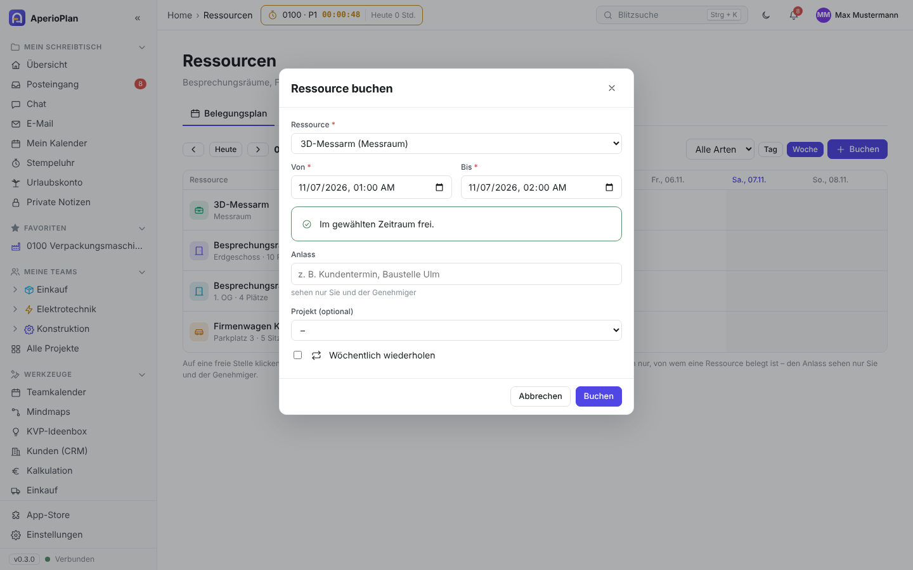

* **Meine Buchungen** listet alle eigenen Buchungen; dort lassen sie sich verschieben oder stornieren – bei Serien wahlweise nur ein Termin oder die ganze Serie.
* **Zu genehmigen** erscheint für Genehmiger und Administratoren.
* Eigene Buchungen stehen zusätzlich in **Mein Kalender**.
* **Datenschutz:** Kollegen sehen nur, *wer* eine Ressource belegt – den Anlass sehen nur Sie, der Genehmiger und Administratoren.

## 9. Kommunikation

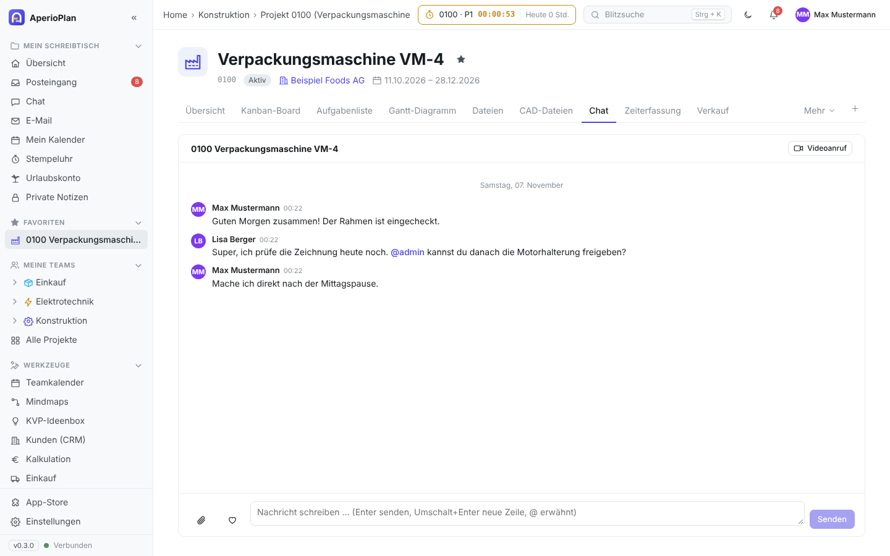

* **Chat:** Projekt-, Team- und Direktnachrichten in Echtzeit. Dateien per Büroklammer oder Einfügen (Strg + V) teilen. Ungelesene Nachrichten zeigt eine rote Zahl.
* **Videoanruf:** Im Chat **Videoanruf** – Kollegen erhalten eine Einladung. Mit **Bildschirm teilen** besprechen Sie z. B. gemeinsam ein CAD-Modell. Keine Zusatzsoftware nötig.
* **E-Mail:** Das Projektpostfach unter **E-Mail**. E-Mails Projekten und Aufgaben zuordnen, beantworten, Anhänge landen im Projektordner. Tipp: Die Projektnummer im Betreff (`[0100]`) sorgt für automatische Zuordnung.

## 10. KVP-Ideenbox

**KVP-Ideenbox → Neue Idee**: Titel, Beschreibung, Abteilung, geschätztes Einsparpotenzial in Euro und Fotos. Die zuständige Teamleitung prüft, entscheidet (*angenommen, umgesetzt, abgelehnt*) und gibt Ihnen eine Rückmeldung.

## 11. KI-Assistent

Falls eingerichtet, erscheint im Projekt der Knopf **KI**:

* **Zusammenfassen:** Fortschritt, Risiken, nächste Schritte des Projekts.
* **Schreibhilfe:** z. B. einen Statusbericht an den Kunden formulieren.
* **Frage stellen:** freie Fragen zum Projekt.

Der Assistent sieht nur Daten, auf die Sie selbst Zugriff haben.

## 11a. Apps aus dem App-Store

Die folgenden Apps erscheinen in der Seitenleiste, sobald Ihre Firma sie installiert hat. Fast überall gilt: **Klick auf eine Zeile öffnet rechts die Details**, Änderungen erscheinen bei allen Kollegen sofort, und die Glocke meldet, wenn Sie etwas tun müssen.

### Zusammenarbeit und Wissen

* **Meetings:** Videokonferenz planen, Gäste treten ohne Konto über einen Link bei und warten, bis Sie sie hereinlassen.
* **Telefonie:** Anrufe über die Firmen-Telefonanlage am PC führen; bekannte Anrufer werden aus dem CRM erkannt.
* **Formulare:** Umfragen und Formulare erstellen, intern oder per Link verteilen, Ergebnisse auswerten.
* **Schwarzes Brett:** Mitteilungen an alle und ein interner Marktplatz.
* **Mindmaps:** Ideen sammeln und ordnen – siehe unten.
* **Wissensdatenbank:** Anleitungen und Abläufe der Firma an einem Ort.

### Mindmaps

In der Mitte steht das Thema, außen herum die Gedanken. Die Mindmaps orientieren sich an FreeMind; Dateien lassen sich mit FreeMind und Freeplane austauschen.

* **Bearbeiten mit der Tastatur:** **Tab** legt einen Unterpunkt an, **Enter** einen Punkt auf gleicher Ebene, einfach **lostippen** oder **F2** ändert den Text, **Entf** löscht, **Leertaste** klappt ein und aus, **Pfeiltasten** wechseln, **Strg + ↑/↓** verschiebt einen Punkt unter seinen Nachbarn. Mit der Maus ziehen Sie Punkte auf andere.
* **Kopieren und Einfügen:** **Strg + C / X / V** kopiert, schneidet aus und fügt Teilbäume ein – auch zwischen Mindmaps. Text aus Word oder einer Liste wird beim Einfügen zur Gliederung.
* **Rückgängig:** Strg + Z, Wiederholen: Strg + Y.
* **Details → Aussehen:** Farbe des Astes, Textfarbe, Hintergrund, **fett** (Strg + B) und *kursiv* (Strg + I), Schriftgröße, Form (Kasten, Blase, Linie), Verbindungslinie (Kurve, Gerade, Eckig) und Stärke, **Wolke** um einen ganzen Ast und **Symbole** wie Idee, Frage, Wichtig, Ziel oder **Priorität 1–5**.
* **Details → Inhalt:** Notiz, Link (Webseite, E-Mail oder Seite in AperioPlan), **Verknüpfung** zu einem anderen Punkt (Klick auf den Pfeil springt hin), **Attribute** (Name und Wert, z. B. *Kosten: 2.400 €*), **Erinnerung** mit Datum und Uhrzeit (alle, mit denen die Mindmap geteilt ist, bekommen dann eine Nachricht), **Pfeile** zu beliebigen anderen Punkten mit Beschriftung, und im Projekt **Als Aufgabe anlegen**. Wann ein Punkt angelegt und zuletzt geändert wurde, steht darunter.
* **Ansicht:** Alles aufklappen, Alles einklappen, Eine Ebene mehr oder weniger zeigen (für den gewählten Punkt und alles darunter), **Als Tabelle** – alle Punkte untereinander mit Notizen, Attributen und Erinnerungen.
* **Suchen (Strg + F):** findet Text in Punkten, Notizen und Attributen; Enter springt zum nächsten Treffer und klappt den Weg dorthin auf. **Filter** blendet alles andere ab.
* **Datei:** Exportieren als Bild (PNG), Vektorgrafik (SVG), PDF, Webseite (HTML), Gliederung (Markdown), Text oder FreeMind-Datei (.mm). **Importieren** fügt eine FreeMind-Datei oder eine Gliederung unter dem gewählten Punkt ein. Eine neue Mindmap können Sie auch **aus einer Datei** anlegen.

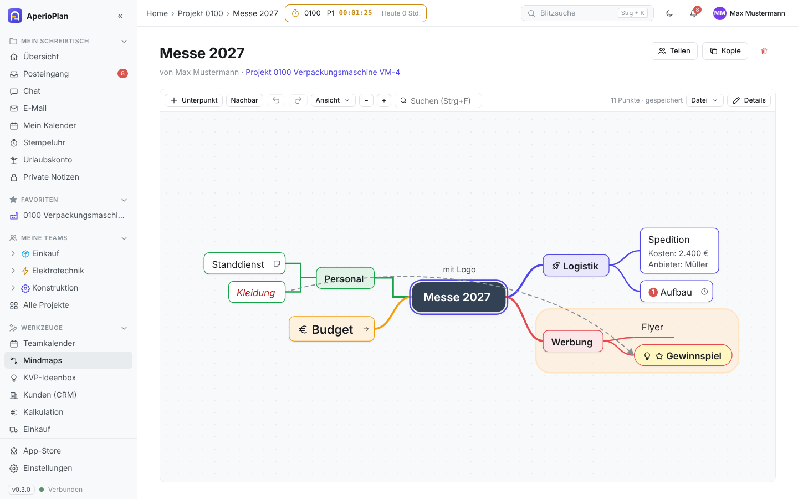

Mindmaps lassen sich mit Kollegen teilen (nur ansehen oder bearbeiten) oder einem Projekt zuordnen. Ändern zwei Personen gleichzeitig, lädt AperioPlan die neueste Fassung und weist darauf hin.

### Freigaben (Anträge)

**Freigaben → Antrag:** Art wählen (z. B. *Anschaffung*, *Weiterbildung*, *Allgemeiner Antrag*), Felder ausfüllen, bei Bedarf Angebot anhängen, **Einreichen**. Wer genehmigen muss – meist Ihre Teamleitung, bei höheren Beträgen zusätzlich die Geschäftsführung – bekommt eine Nachricht. Den Stand sehen Sie unter **Meine Anträge**; offene Anträge können Sie zurückziehen.

Genehmigen Sie selbst Anträge, finden Sie diese unter **Zu genehmigen**. Bei einer Ablehnung ist eine kurze Begründung Pflicht.

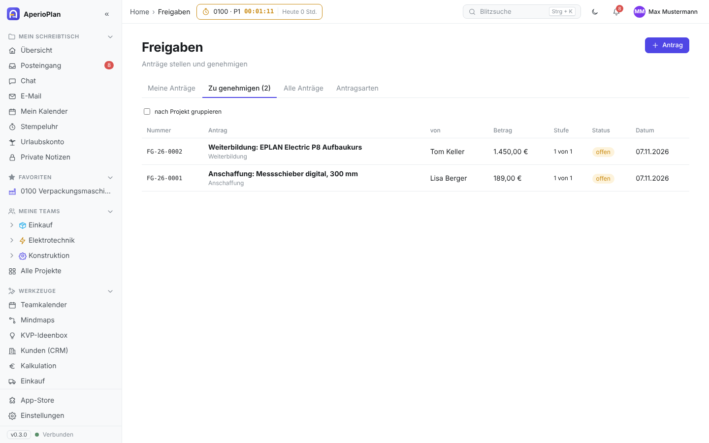

### E-Signatur

**E-Signatur → Dokument zur Unterschrift:** PDF wählen, Unterzeichner eintragen (Kollegen oder Externe mit E-Mail), auf Wunsch „nacheinander“ ankreuzen, **Anlegen** und dann **Absenden**. Jeder Unterzeichner erhält einen persönlichen Link, sieht das Dokument und unterschreibt mit Maus, Finger oder Stift. Nach der letzten Unterschrift bekommen alle das Dokument mit **Signaturprotokoll** per E-Mail.

Liegt etwas für Sie zum Unterschreiben bereit, steht es oben auf der Seite E-Signatur und in der Glocke.

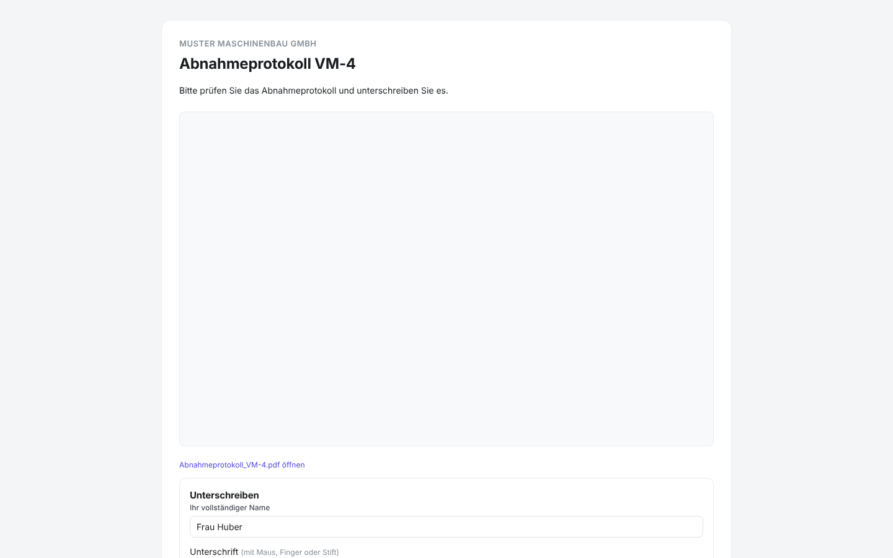

> Die E-Signatur ist eine *einfache elektronische Signatur*. Sie genügt für Angebote, Aufträge, Abnahmen und die meisten Verträge – nicht aber, wo das Gesetz die Schriftform verlangt (z. B. Kündigung eines Arbeitsvertrags).

### Auswertungen

**Auswertungen → Bericht:** Datenquelle wählen (z. B. Arbeitszeiten, Aufgaben, Verkaufschancen, Umsatz), dann **Kennzahl**, **Gruppiert nach** (Monat, Projekt, Mitarbeiter …) und den **Zeitraum**. Mit **Unterteilt nach** bekommt jeder Wert eine eigene Farbe. Darstellung als Säulen, Balken, Linie, Tabelle oder große Kennzahl. **Speichern** heftet den Bericht an die Übersicht, **Excel** lädt die Zahlen herunter. Sie sehen nur Daten, die Sie auch im jeweiligen Werkzeug sehen dürfen.

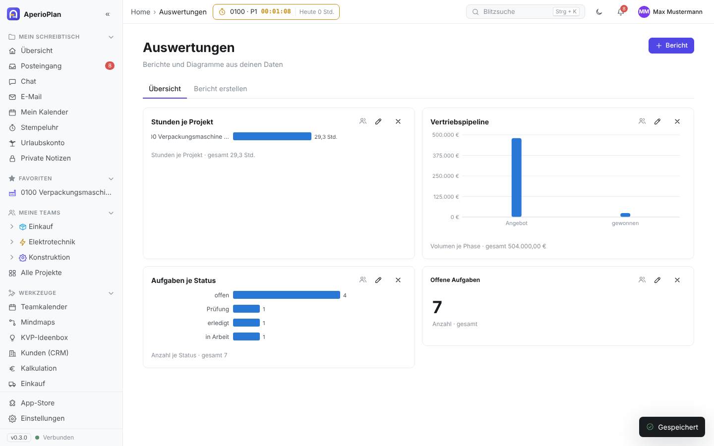

### Eigene Felder

Hat Ihre Firma eigene Felder angelegt (z. B. *Kostenstelle* am Projekt oder *Kundenklasse* am Kunden), erscheinen sie im Datensatz unter **Weitere Angaben**. Eingaben werden beim Verlassen des Feldes gespeichert.

### Kunden und Service

* **Kundenanfragen:** Anfragen aus dem Web-Formular, per E-Mail oder Telefon als Ticket mit Nummer. Antworten gehen per E-Mail an den Kunden; interne Notizen sieht nur das Team. Oben zeigt die Übersicht, wie viele Anfragen offen sind und wie schnell geantwortet wird.
* **Service-Einsätze:** Einsatz planen, vor Ort **Losfahren → Vor Ort**, Arbeitszeit und Material eintragen, den Kunden auf dem Tablet unterschreiben lassen. Der Servicebericht entsteht als PDF, die Rechnung als Entwurf.
* **Wartungsverträge:** wiederkehrende Leistungen; Rechnungen entstehen automatisch zum Fälligkeitstag.
* **Terminbuchung:** Kunden buchen über Ihren Link freie Termine; belegte Zeiten aus Ihrem Kalender und Urlaub sind gesperrt.
* **Messen und Veranstaltungen:** Planung, Standkontakte erfassen und ins CRM übernehmen, Anmeldungen über eine öffentliche Seite.

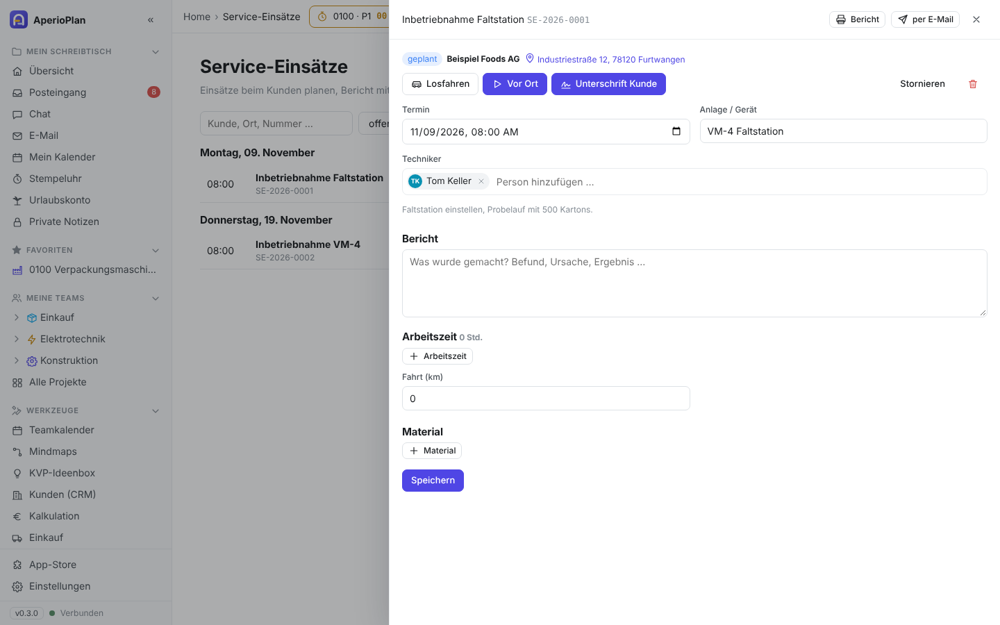

### Produktion

* **Instandhaltung:** Wartungspläne für Maschinen; **Störung melden** direkt am Gerät im Inventar oder per QR-Code.
* **Qualität:** Prüfpläne, Prüfprotokolle mit Messwerten, Messmittel mit Kalibrierfristen, 8D-Reports.
* **Fertigung:** Fertigungsaufträge aus der Stückliste, Arbeitsgänge an der Maschine zurückmelden.
* **Änderungsmanagement:** Änderungsantrag zu einem Teil stellen, prüfen lassen, freigeben.

### Personal

* **Spesen und Reisekosten:** Für jede Reise eine Abrechnung anlegen, Beginn und Ende eintragen (die Verpflegungspauschale rechnet AperioPlan aus), Belege fotografieren, Kilometer erfassen, **Einreichen**. Die Teamleitung gibt frei, die Buchhaltung zahlt aus.
* **Einsatzplanung:** Ihre Schichten der Woche; offene Schichten können Sie mit **Übernehmen** selbst belegen.
* **Meine Unterlagen:** Dokumente aus Ihrer Personalakte, die für Sie freigegeben sind, geteilte Gesprächsprotokolle mit Zielen (abhakbar) und Ihre Qualifikationen.
* **Unterweisungen:** Fällige Pflichtunterweisungen öffnen, Inhalt lesen, Verständnisfragen beantworten und **Teilnahme bestätigen** – der Nachweis entsteht automatisch.
* **Meine Lohnzettel:** Ihre Lohn- und Gehaltsabrechnungen als PDF.

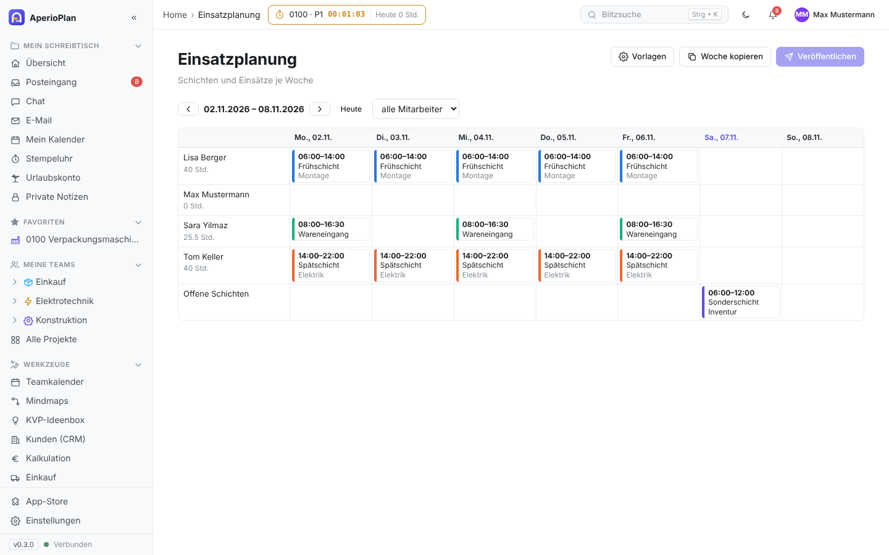

### Lager, Fahrzeuge, Finanzen

* **Lager:** Bestände je Lagerort, Zugang, Entnahme und Umlagern, Etiketten mit QR-Code. Am Artikel stehen die **offenen Bestellungen** (mit Bestellnummer, Lieferant und Projekt); **Nachbestellen** legt eine Lagerbestellung im Einkauf an. Der **Bestellvorschlag** zeigt, was unter den Mindestbestand fällt.
* **Einkauf:** Unter **Alle Positionen** sehen Sie alle Bestellungen, nach Projekt geordnet; Bestellungen fürs Lager ohne Projekt stehen unter **Lagerbestellungen**. Eine Position kann mit einem **Lagerartikel** verknüpft sein – dann übernimmt AperioPlan Benennung, Lieferant und Preis.
* **Wareneingang:** In der Bestellposition (oder im Lager unter **Wareneingang**) Menge, Datum und **Lieferschein-Nr.** eintragen und wählen, was mit der Ware passiert: **ins Lager einlagern**, **einlagern und gleich fürs Projekt entnehmen** oder **nur den Eingang buchen**. Bei Artikeln mit Charge oder Seriennummern werden diese abgefragt; fehlt der Lagerartikel, legt AperioPlan ihn an. Unter **Verlauf und Warenfluss** sehen Sie für jede Position, wann sie bestellt, geliefert, eingelagert und entnommen wurde.

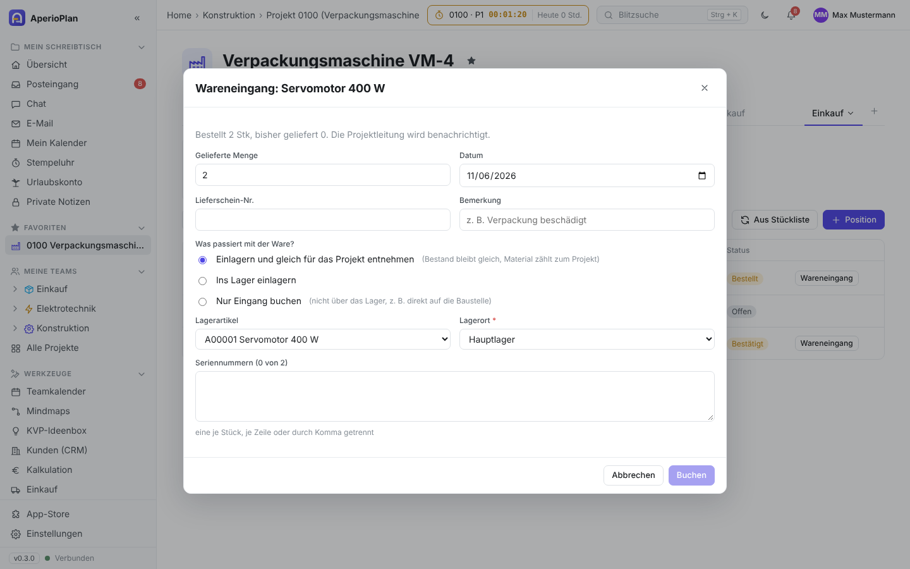
* **Inventar:** Geräte und Maschinen mit Prüfterminen, Übergabe an Mitarbeiter, Abschreibung.
* **Fuhrpark:** Fahrten ins elektronische Fahrtenbuch eintragen (Beginn, Ende, Zweck), Tankbelege und Schäden melden. Das Fahrtenbuch lässt sich nachträglich nicht ändern – nur die letzte Fahrt der vergangenen 7 Tage kann gelöscht werden.
* **Rechnungen und Finanzen:** für die Buchhaltung – Rechnungen als E-Rechnung, Eingangsrechnungen freigeben, Zahlungen zuordnen, Mahnungen. Eine Eingangsrechnung gehört zu einem Projekt, wenn Sie sie im Projekt hochladen, im Beleg das Projekt wählen – oder automatisch, wenn eine E-Rechnung die Bestellnummer aus dem Einkauf enthält.
* **Nachhaltigkeit:** Strom-, Gas- und Kraftstoffverbrauch und daraus die CO₂-Bilanz je Monat, Projekt und Standort.

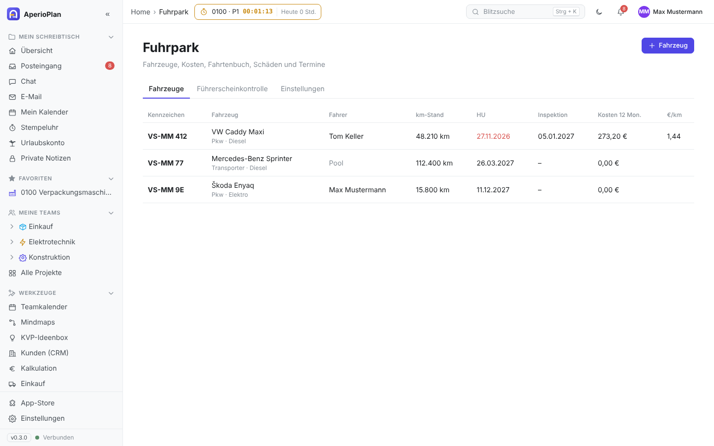

## 12. Tastenkürzel

| Kürzel | Funktion |
|---|---|
| Strg + K | Blitzsuche |
| Strg + \\ | Seitenleiste ein-/ausklappen |
| Esc | Fenster schließen |
| Strg + Enter | Kommentar senden |
| Enter / Umschalt + Enter | Chat: senden / neue Zeile |
| Entf | Whiteboard: Auswahl löschen |
| Tab / Enter | Mindmap: Unterpunkt / Punkt auf gleicher Ebene |
| Strg + C / X / V | Mindmap: Teilbaum kopieren, ausschneiden, einfügen |
| Strg + B / I | Mindmap: fett / kursiv |
| Strg + F | Mindmap: suchen |
